<p align="center">
  
</p>

<p align="center">
  Football tracking data, explained: live during the match, and in depth the day after.
</p>

<p align="center">
  <a href="https://github.com/Anaximandr0s/football-data-platform/actions/workflows/ci.yml"></a>
  
  <a href="https://github.com/Anaximandr0s/football-data-platform/releases"></a>
  <a href="LICENSE"></a>
  
</p>

<p align="center">
  
  
  
  
  
  
  
  
  
  
  
  
  
</p>

<p align="center">
  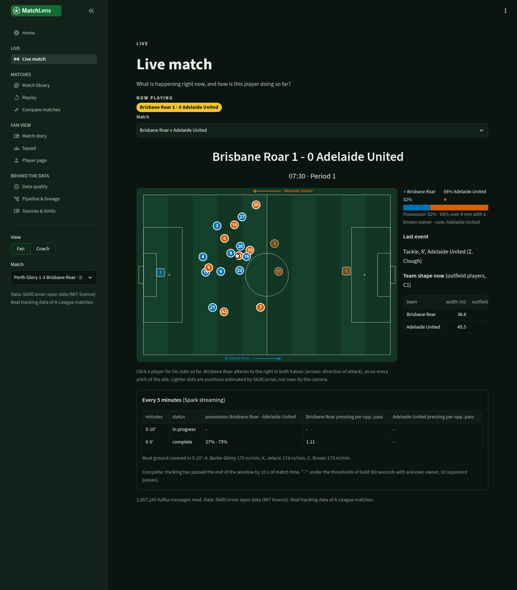
</p>

## Why MatchLens

One football match produces about 1.4 million positions: 22 players and the ball, 10 times a second, for about
100 minutes. Nobody can read that. Professional analysis tools turn it into answers, but they are expensive and built
for analysts, so a fan sees possession and shot counts with no story, and a small club has no analyst to ask.

MatchLens replays real matches as a live feed, follows them second by second, and rebuilds every statistic once the
final whistle blows. Every number on screen is checked and its definition is one click away.

## Who it is for

<table>
  <tr>
    <td width="96" align="center"></td>
    <td>
      <b>The fan</b>: "I want to understand my team."<br>
      Who dominated the match? <b>Match story</b>: possession and danger, minute by minute.<br>
      Who was the best player? <b>Player card</b>: five ratings out of 100, shots and passes.<br>
      Why did we lose? <b>Three key differences</b>, in plain sentences.
    </td>
  </tr>
  <tr>
    <td align="center"></td>
    <td>
      <b>The club coach</b>: "I want to understand how we play."<br>
      Did our pressing work? <b>Team analysis</b>: pressing by quarter-hour and by zone.<br>
      Who tires, and when? <b>Physical and fatigue</b>: the drop in intensity of each player.<br>
      Home or away, the same team? <b>Compare matches</b>: the team's profile, match by match.
    </td>
  </tr>
  <tr>
    <td align="center"></td>
    <td>
      <b>The national-team head coach</b>: the day after a match, they want fast, clear and reliable answers.<br>
      Where did our pressing give way? Which players tired, and at what moment? How does the next opponent play in its
      other matches? The match is in Gold 2.5 minutes after the final whistle, with the same pages as the club coach.
    </td>
  </tr>
</table>

| Match story (fan view) | Team analysis (coach view) | Player card (fan view) |
|---|---|---|
| 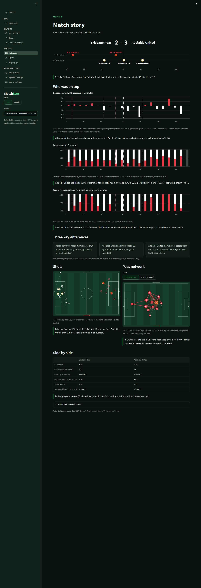 | 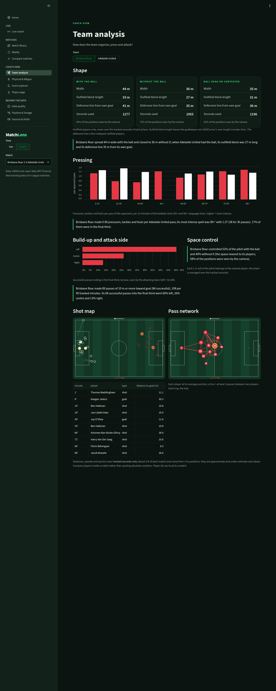 | 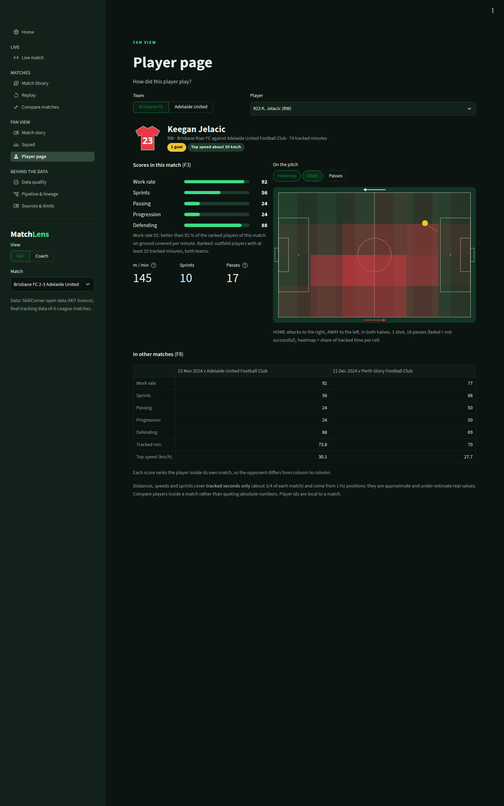 |

More pages: [replay](docs/img/replay_goal_banner_m001.png) with the Voronoi space of each player,
[player card for the coach](docs/img/player_coach_m001.png), [data quality](docs/img/data_quality_dimensions.png) and
[pipeline lineage](docs/img/app_pipeline_lineage.png). Every page has a light and a dark theme and a palette that
stays readable with [colour blindness](docs/img/readability/pitch_deuteranopia.png).

## Quick start

Needs Docker with Compose, Python 3.11+, `make`, and about 1 GB of disk. On Windows, read
[`docs/windows.md`](docs/windows.md) first.

```bash
git clone https://github.com/Anaximandr0s/football-data-platform.git && cd football-data-platform
python -m venv .venv && . .venv/bin/activate && pip install -r requirements.txt
make matches demo demo-reset     # download the 4 matches, start everything, replay each one at x60
```

Then open the Control Center on http://localhost:8000. `make up` creates `.env` from `.env.example`: change the
passwords there before exposing any port.

## Manage it from the Control Center

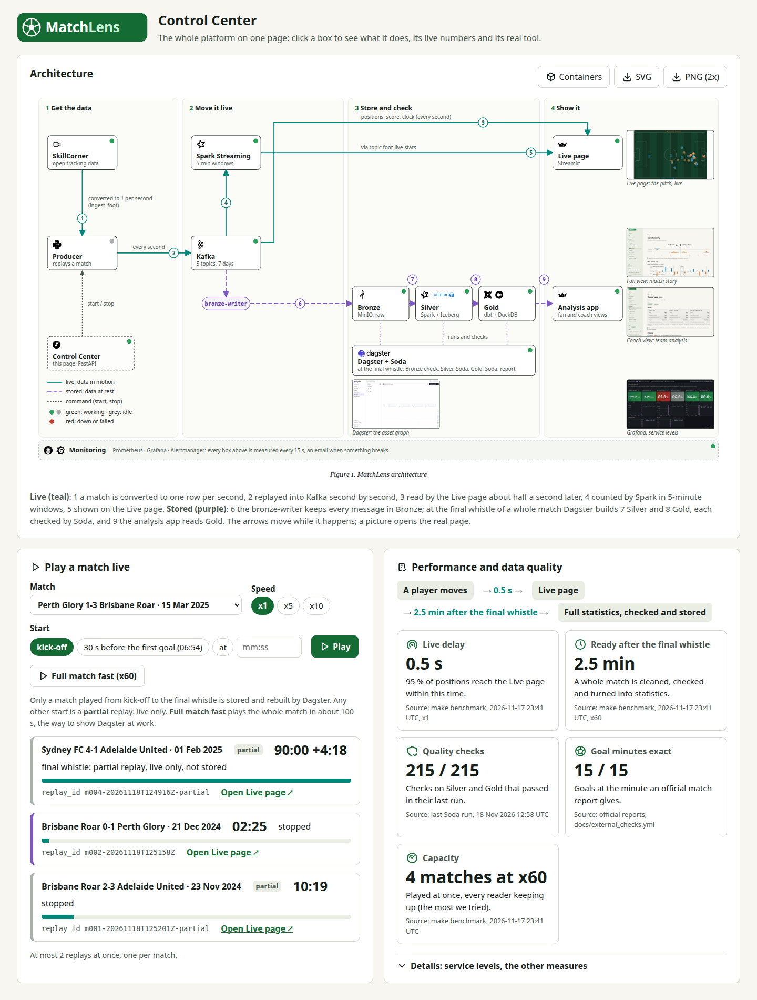

One local page to run and watch the whole platform without typing a command:

- **Architecture with live status**: a light on each box (Kafka, Spark, MinIO, Dagster, Soda, the apps) from
  Prometheus. Click a box for its role, its live numbers and a link to its own tool.
- **Play a match**: pick one of the four, a speed (x1, x5, x10) and a start (kick-off, 30 s before the first goal, or
  a match clock such as 47:30). Its progress is what Kafka actually received. At most two replays at once.
- **Pipeline runs**: the Dagster step each replay is on, from Bronze to the match report.
- **Performance and quality**: live delay, freshness, check results and capacity, measured, with their date.

Starting and stopping a replay are its only two actions; everything else is read-only. Details:
[`app/api/README.md`](app/api/README.md).

| Service | URL |
|---|---|
| Control Center | http://localhost:8000 |
| Dashboard (Streamlit) | http://localhost:8501 |
| Dagster | http://localhost:3000 |
| Grafana | http://localhost:3001 |
| Kafka UI | http://localhost:8081 |
| MinIO console | http://localhost:9001 |
| Spark master UI | http://localhost:8082 |

Every port is bound to `127.0.0.1`. `make help` lists every command; `make down` stops the stack and keeps the data,
`make reset` deletes it.

## How it works

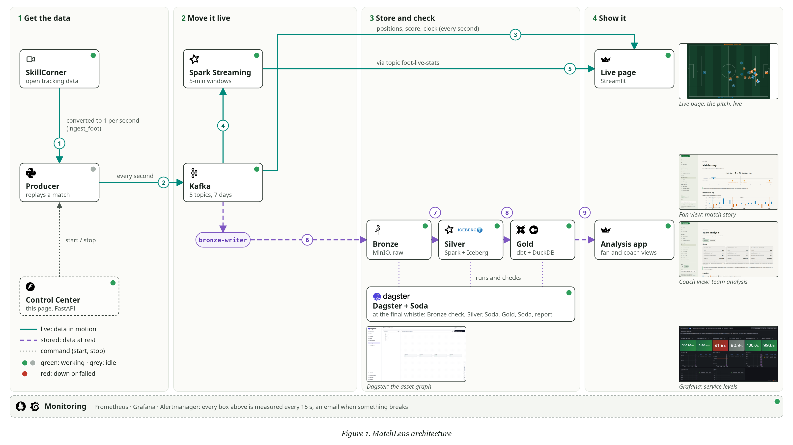

1. **Get the data.** SkillCorner open data is downloaded and converted to five Parquet tables, one position per player
   per second (`ingestion/`).
2. **Move it live.** A producer replays a match into five Kafka topics at x1 to x60, every message tagged with its
   replay. Spark Structured Streaming computes 5- and 15-minute statistics into a compacted topic, and the Live page
   shows the pitch, the score and those statistics.
3. **Store and check.** A writer stores the raw messages in MinIO (Bronze). At the final whistle a Dagster sensor runs
   the match's chain: Bronze count check, Spark job to Iceberg tables (Silver), Soda checks, dbt models in DuckDB
   (Gold, 17 tables), Soda checks again, match report. A failed check stops what follows.
4. **Show it.** The Streamlit app reads Gold for the fan and coach views; the Control Center and Grafana show the
   platform itself.

Layers, topics, partitioning and design decisions: [`docs/architecture.md`](docs/architecture.md).

## The dataset

[SkillCorner open data](https://github.com/SkillCorner/opendata) (MIT licence): broadcast tracking of the Australian
A-League, season 2024/25. Three files per match, about 100 MB: the match sheet (teams, lineups, score, pitch size), the
tracking (x, y of the 22 players and x, y, z of the ball, 10 frames a second) and the events (passes, shots, pressing,
runs; more than 300 columns).

| Id | Match | Date |
|---|---|---|
| m001 | Brisbane Roar 2-3 Adelaide United | 23 Nov 2024 |
| m002 | Brisbane Roar 0-1 Perth Glory | 21 Dec 2024 |
| m003 | Perth Glory 1-3 Brisbane Roar | 15 Mar 2025 |
| m004 | Sydney FC 4-1 Adelaide United | 1 Feb 2025 |

What to know about it, measured on these matches:

- **Broadcast gaps.** Only the pitch the TV shows is tracked: 73 % of the seconds of m001 have positions, and the
  longest gap lasts 2 min 23 s. Distances and sprints cover tracked time only.
- **Estimated positions.** A player outside the TV frame is placed by SkillCorner's model (about 42 % of the rows);
  MatchLens keeps these positions and flags them (`is_detected`).
- **One position per second.** The 10 frames a second are reduced to 1 per player: 97,416 tracking rows for m001
  instead of about 974,000.
- **Derived values.** Speed comes from positions one second apart, and goals from the score. The derived goals match
  the real score in all four matches.

Raw files are downloaded to `data/raw` and never committed. Sources, limits and how to add a match:
[`docs/data-sources.md`](docs/data-sources.md). Every table and column: [`docs/contrat_donnees.md`](docs/contrat_donnees.md).

## Monitoring

Prometheus scrapes every service every 15 s, Grafana shows four dashboards, and Alertmanager sends an email when a
container stops, consumer lag grows, the streaming job stalls, or a pipeline run or a check fails.

| Service levels | Pipeline |
|---|---|
| 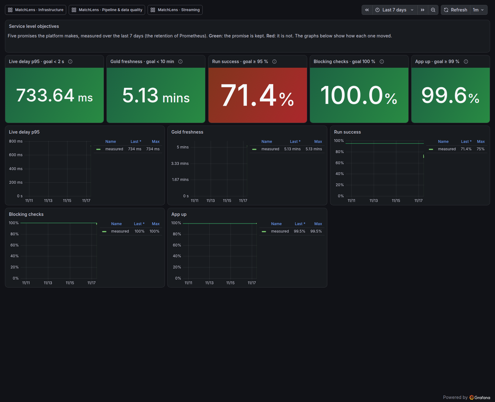 | 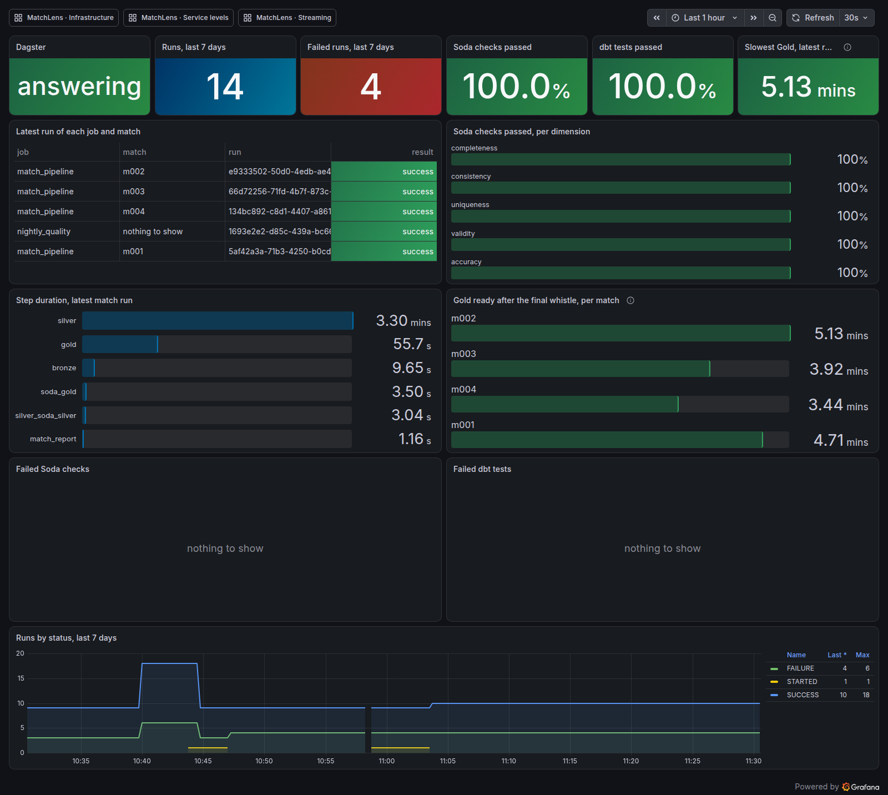 |
| **Streaming during a replay** | **Infrastructure** |
| 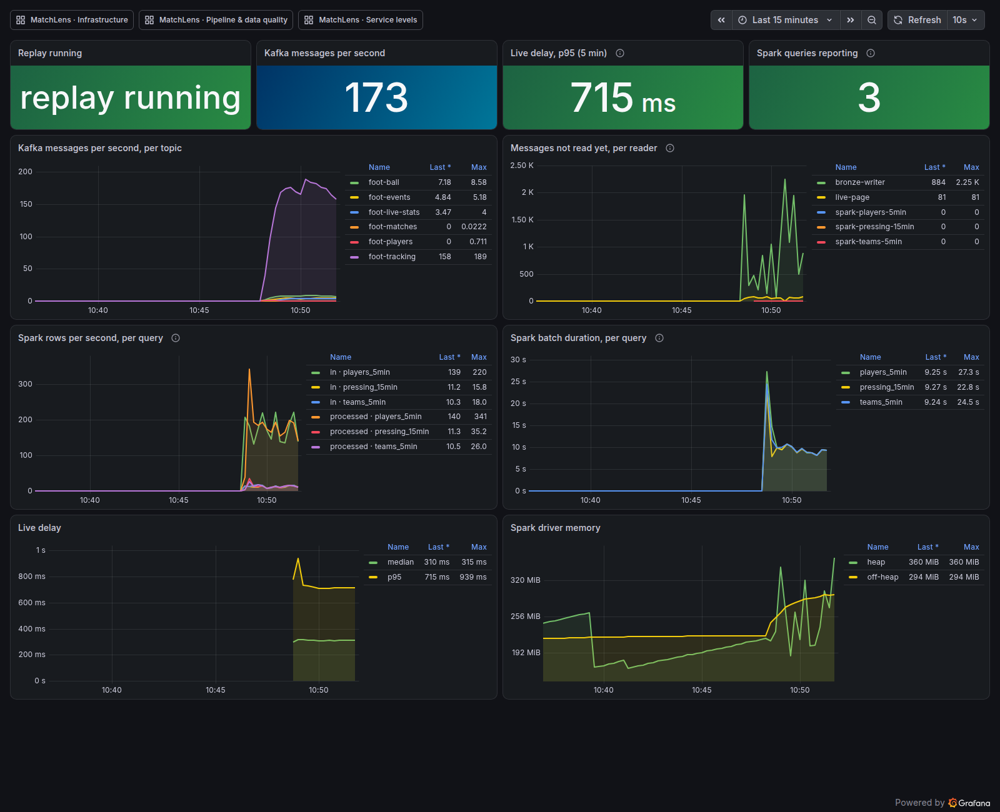 | 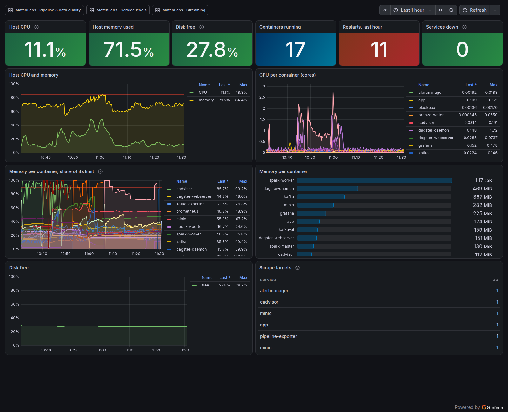 |

Measured on one laptop (Ryzen 5 7530U, 14 GiB, everything in Docker) by `make benchmark`:

| Service level | Target | Measured |
|---|---|---|
| Live delay, p95 at x1 | < 2 s | 0.49 s |
| Final whistle to Gold ready | < 10 min | 2.5 min |
| Pipeline run success over 7 days | ≥ 95 % | 90.9 % (96.2 % since the last fix) |

Throughput, latency, load test and recovery: [`docs/performance.md`](docs/performance.md). Dashboards and alerts:
[`monitoring/README.md`](monitoring/README.md).

## Data quality

Soda Core runs 73 checks on Silver and 136 on Gold, each mapped to a quality dimension (completeness, uniqueness,
validity, consistency, accuracy). They run inside the Dagster chain and block it on failure, and again every night.
`make soda-demo` damages a copy of the data to show the checks catching it. Silver also refuses a match whose row
counts or goals differ from the source.

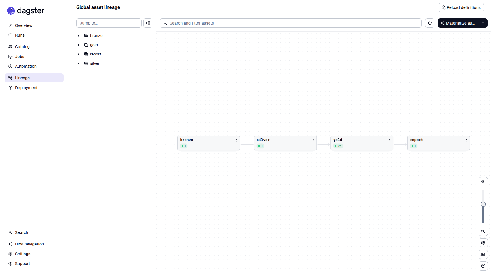

## Tests

```bash
make ci            # lint, tests with coverage, config checks
```

- 308 tests, no Docker needed: Kafka, S3 and HTTP are replaced by small fakes, while Spark, DuckDB, dbt and Dagster run
  for real on a small hand-made match.
- CI on every pull request: lint, unit tests, Soda tests in their own environment, combined coverage of at least
  90 %, Prometheus and Alertmanager config checks, and a build of every Docker image.
- Pushing a `vX.Y.Z` tag runs the same CI, then publishes a GitHub release.

## Limits

- Runs on one machine: single Kafka broker, single MinIO node, no login on the apps. It is a demonstration platform,
  not a hosted service.
- The data is broadcast tracking: about a quarter of each match has no positions, and some positions are estimated.
- Matches are compared at team level; players are followed across matches on their page, but not grouped into
  profiles.
- Run success is under its 95 % target over 7 days; the failed runs and their causes are in
  [`docs/performance.md`](docs/performance.md).

## Documentation

| Part | Read |
|---|---|
| Ingestion: download, convert, replay, Bronze | [`ingestion/README.md`](ingestion/README.md) |
| Silver: the Spark job | [`spark/silver/README.md`](spark/silver/README.md) |
| Gold: dbt models and definitions | [`dbt/README.md`](dbt/README.md) |
| Data quality: Soda checks | [`soda/README.md`](soda/README.md) |
| Orchestration: Dagster | [`dagster/README.md`](dagster/README.md) |
| Dashboard: pages and how to read them | [`app/streamlit/README.md`](app/streamlit/README.md) |
| Control Center | [`app/api/README.md`](app/api/README.md) |
| Monitoring | [`monitoring/README.md`](monitoring/README.md) |
| Product: views, pages and statistics | [`docs/product.md`](docs/product.md) |
| Data contract | [`docs/contrat_donnees.md`](docs/contrat_donnees.md) |
| Contributing, security | [`CONTRIBUTING.md`](CONTRIBUTING.md), [`SECURITY.md`](SECURITY.md) |

## Licence

Code under the [MIT licence](LICENSE). Data by SkillCorner (MIT), not redistributed here. Third-party code, icons and
logos: [`NOTICE`](NOTICE).

---

<p align="center">Made with love by <a href="https://github.com/Anaximandr0s">@Anaximandr0s</a> and <a href="https://github.com/Et-taky">@Et-taky</a>.</p>
