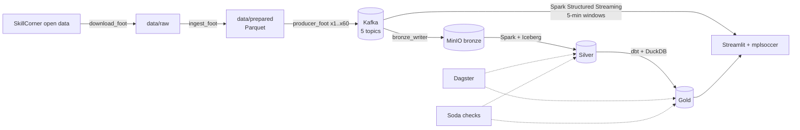

# Football Data Platform

A data platform for a club that follows a match live and analyses it afterwards. A real match
(22 players tracked every second, about 1,800 game actions) is replayed into Kafka at speed x1 to x60,
stored in a bronze / silver / gold lakehouse and shown in a Streamlit app.

> 100 % open source · data: [SkillCorner open data](https://github.com/SkillCorner/opendata) (MIT licence)

## Architecture



Two paths: **batch** (bronze → silver → gold, run by Dagster) and **stream** (live display).
Details: [`docs/architecture.md`](docs/architecture.md). The ingestion part: [`ingestion/README.md`](ingestion/README.md).

## Status

| Phase | Content | State |
|---|---|---|
| Source | download and convert two real matches (m001, m002) | done |
| Ingestion | replay into Kafka at x1..x60, 5 topics | done |
| Bronze | MinIO, partitioned by match, counts verified | done |
| Silver | Spark + Iceberg: cleaning, grain player x second | code and unit tests done, to run on the stack ([`spark/silver/README.md`](spark/silver/README.md)) |
| Gold | dbt + DuckDB: 6 tables, tests, export to `s3://gold` | code and tests done, to run on the stack ([`dbt/README.md`](dbt/README.md)) |
| Checks | Soda Core on Silver and Gold, 73 + 136 checks, failure demo | code and tests done, to run on the stack ([`soda/README.md`](soda/README.md)) |
| Streaming stats (optional) | Spark Structured Streaming: 5- and 15-minute windows to the topic `foot-live-stats`, shown on Live; equal to Gold after a full replay ([`spark/streaming/live_stats.py`](spark/streaming/live_stats.py)) | done |
| Orchestration | Dagster: the end of a replay runs bronze check -> Silver -> Soda -> Gold -> Soda -> report for its match; a failed check blocks what follows ([`dagster/README.md`](dagster/README.md)) | done |
| Presentation | Streamlit + mplsoccer dashboard on Gold (live pitch page still to do) | code and tests done, to run on the stack ([`app/streamlit/README.md`](app/streamlit/README.md)) |

## Quick start

Needs Docker with Compose, Python 3.11+, `make` (optional) and about 1 GB of disk.
On Windows, read [`docs/windows.md`](docs/windows.md) first.

```bash
git clone https://github.com/Anaximandr0s/football-data-platform.git && cd football-data-platform
cp .env.example .env                      # then change MINIO_ROOT_PASSWORD
python -m venv .venv && source .venv/bin/activate    # or: uv venv .venv
pip install -r requirements.txt           # or: uv pip install -r requirements.txt

make up                                   # MinIO, Kafka, Kafka UI, Spark cluster, Bronze writer; buckets and topics created
make ps
make smoke                                # must end with ALL OK
make lint
make test
make data MATCH=m001 SC_ID=1874553        # download (~100 MB) + convert match 1
make data MATCH=m002 SC_ID=1925299        # same for match 2

make replay MATCH=m001                    # replay at x60, about 100 seconds (the bronze-writer service stores it)
make replay MATCH=m002
make check MATCH=m001                     # bronze row counts must say OK
make check MATCH=m002

make silver MATCH="m001 m002"            # Silver on the Spark cluster (ARGS=--dry-run to only check)
make gold                                # Gold: dbt + DuckDB, tests, export to s3://gold
make gold-sql Q="select * from gold_shots limit 5"
make soda                                # Soda checks on Silver then Gold (make soda-demo shows a failure on purpose)
make app                                 # dashboard on http://localhost:8501
make dagster                             # Dagster on http://localhost:3000: the next replay's end runs the chain
make monitoring                          # Prometheus, alert emails, Grafana on http://localhost:3001 (monitoring/README.md)
make demo                                # everything for the demo, then the Control Center on http://localhost:8000
make benchmark                           # ~1 h, laptop busy: throughput, latency, load, recovery -> docs/performance.md
```

| Service | URL | Notes |
|---|---|---|
| MinIO console | http://localhost:9001 | user and password from `.env` |
| MinIO S3 API | http://localhost:9000 | buckets `bronze`, `silver`, `gold` |
| Kafka UI | http://localhost:8081 | topics, messages, consumer groups |
| Spark master UI | http://localhost:8082 | cluster for Silver (`spark://spark-master:7077` inside Docker) |
| Dashboard | http://localhost:8501 | after `make app` (needs `make gold`) |
| Dagster | http://localhost:3000 | after `make dagster` |
| Control Center | http://localhost:8000 | after `make demo`: the architecture with live status, play a match, performance |
| Grafana | http://localhost:3001 | after `make monitoring`; login from `.env`; Prometheus :9090, Alertmanager :9093 |
| Kafka from your machine | `localhost:29092` | Python scripts and Spark outside Docker |
| Kafka from containers | `kafka:9092` | |

Other commands: `make silver` · `make gold` · `make soda` · `make app` · `make help` · `make down` (keep data) · `make reset` (**deletes all data**) ·
`make counts` (messages per topic) · `make lint` · `make test`.

Troubleshooting:
- Replaying the same match twice doubles its rows in Kafka and bronze. This is expected: Silver deduplicates.
- Windows: see [`docs/windows.md`](docs/windows.md).

## Repository layout

| Folder | Content | State |
|---|---|---|
| `ingestion/` | download, convert, replay into Kafka, bronze writer ([guide](ingestion/README.md)) | done |
| `tests/<part>/` | Python tests, one folder per part (`tests/ingestion/`, `tests/spark/`, `tests/dbt/`, `tests/soda/`, `tests/app/`) | ingestion to dashboard done |
| `scripts/` | `smoke_test.py`: health of the Docker stack | done |
| `docs/` | contract, guides, ADRs | in progress |
| `spark/` | Silver job (`spark/silver/`, [guide](spark/silver/README.md)); streaming job (`spark/streaming/`, `make streaming`) | done |
| `dbt/` | Gold models, dbt tests, Dockerfile ([guide](dbt/README.md)) | Gold code done |
| `soda/` | data-quality checks on Silver and Gold, runner, Dockerfile ([guide](soda/README.md)) | Soda code done |
| `dagster/` | Dagster assets, sensor, schedule, image ([guide](dagster/README.md)) | done |
| `app/` | Streamlit dashboard (`app/streamlit/`, [guide](app/streamlit/README.md)), optional 3D page (`app/web3d/`) and API | dashboard code done, live page and bonus to do |

## Documentation

- Silver job (what it does, tables, decisions, checks): [`spark/silver/README.md`](spark/silver/README.md)
- Gold layer (tables, definitions, tests, how to run): [`dbt/README.md`](dbt/README.md)
- Data quality (what is checked, the failure demo): [`soda/README.md`](soda/README.md)
- Dashboard (pages, how to read the graphics): [`app/streamlit/README.md`](app/streamlit/README.md)
- Ingestion guide (files, outputs, how to verify): [`ingestion/README.md`](ingestion/README.md)
- Data contract (every table, column, rule): [`docs/contrat_donnees.md`](docs/contrat_donnees.md)
- Where the data comes from and its limits: [`docs/data-sources.md`](docs/data-sources.md)
- Architecture and decisions: [`docs/architecture.md`](docs/architecture.md), [`docs/adr/`](docs/adr/)
- How we work: [`CONTRIBUTING.md`](CONTRIBUTING.md)

## Possible extensions (not started)

- A live 3D page: positions, ball height and kit colours are already in the data.
- Player-level comparison between matches (needs a persistent player id; today ids are match-local).

## Open-source tools and data

MinIO (AGPLv3) · Apache Kafka, Kafka UI (Apache-2.0) · Spark, Iceberg, Dagster, dbt-core, DuckDB,
Soda Core, Streamlit, mplsoccer (Apache-2.0 / MIT). Verify licences when adding a tool.
Tracking and event data: SkillCorner open data (MIT). Credit SkillCorner in the app and the report.

---

Made with love by [@Anaximandr0s](https://github.com/Anaximandr0s) and [@Et-taky](https://github.com/Et-taky).
