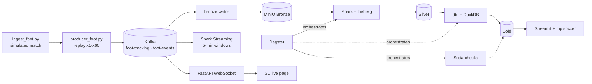

# ⚽ Football Data Platform (Sujet 5 · Match de football)

End-to-end data platform for a fictional club: follow a 90-minute match **live**
(22 players, 1 position/second, ~1 600 game actions), then analyse it after the whistle.

> Team: **<Person A>** (Flux & Lakehouse) · **<Person B>** (Analytique & Produit)
> Course: Projets fil rouge · 100 % open source · all data is synthetic

## Architecture



Two paths: **batch** (Bronze → Silver → Gold, driven by Dagster) and **stream** (live display).
Details: [`docs/architecture.md`](docs/architecture.md).

## Quick start (< 5 commands)

```bash
git clone <repo-url> && cd football-data-platform
cp .env.example .env            # then change MINIO_ROOT_PASSWORD
docker compose up -d
make smoke                      # checks MinIO, Kafka, topics, buckets
```

| Service | URL | Notes |
|---|---|---|
| MinIO console | http://localhost:9001 | user/password from `.env` |
| Kafka UI | http://localhost:8081 | topics, messages, consumer groups |
| Kafka (from laptop) | `localhost:29092` | Python scripts |
| Kafka (from containers) | `kafka:9092` | |

Stop: `make down` · Wipe everything: `make reset` · All commands: `make help`.

## Repository layout

| Folder | Phase | Owner | Content |
|---|---|---|---|
| `data_gen/` | 1-2 | A | match simulator, Kafka replay producer |
| `kafka/` | 2 | A | topic conventions, consumer scripts |
| `spark/` | 3-4, 7 | A | Bronze→Silver jobs, Iceberg, streaming job |
| `dbt/` | 5 | B | Gold models, tests, docs |
| `soda/` | 6 | B | data-quality checks |
| `dagster/` | 8 | B | assets, schedules, sensors |
| `app/streamlit/` | 9 | B | required Streamlit + mplsoccer app |
| `app/web3d/` | 9 | B | 3D live page (Three.js) |
| `app/api/` | 9 | B | WebSocket gateway Kafka → browser |
| `docs/` | all | both | architecture, data contract, ADRs, report |
| `scripts/` | all | both | smoke test and helpers |

## Requirements coverage

See [`docs/requirements-coverage.md`](docs/requirements-coverage.md) (FOO-01 … FOO-09 with status and proof).

## Working together

Read [`CONTRIBUTING.md`](CONTRIBUTING.md). The data contract between A and B is
[`docs/contrat_donnees.md`](docs/contrat_donnees.md): change it only through a PR.

## Open-source tools

MinIO (AGPLv3) · Apache Kafka (Apache-2.0) · Kafka UI (Apache-2.0) · Spark, Iceberg, Dagster, dbt-core,
DuckDB, Soda Core, Streamlit, mplsoccer, Three.js (Apache-2.0 / MIT). Verify licences when adding tools.
