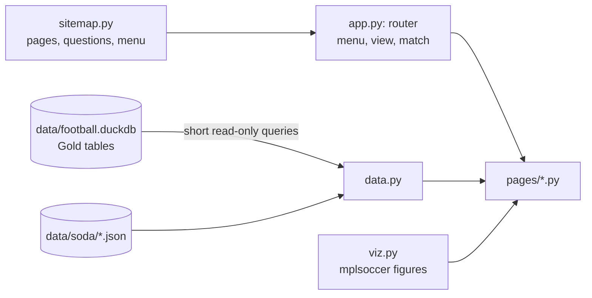

# MatchLens (Streamlit + mplsoccer)

One website, the app map of [`docs/product.md`](../../docs/product.md) section 8: Home, then the sections LIVE, MATCHES,
FAN VIEW or COACH VIEW (the one chosen on Home), and BEHIND THE DATA. The Gold pages compute nothing that Gold does not
already hold: they select, filter and draw, and open the data read-only. The Live match page rebuilds the score,
possession and positions from the replayed Kafka messages.



## Run it

Needs `make silver` and `make gold` done (`make soda` fills the quality page):

```bash
make app            # builds the image, starts the dashboard: http://localhost:8501
make app-stop       # stops it  (`make down` stops it too)
```

Without Docker: `pip install -r requirements.txt`, then `streamlit run app/streamlit/app.py`. Without any Gold file the
pages say what to run instead of crashing.

## Pages

Home asks for a match and a view; the menu then shows that view's section, and the sidebar keeps a view switch and the
match picker. The view and the match are plain session keys (`view`, `match_id`), so they follow the visitor from page
to page. A page marked "coming soon" states its question and the build step (product.md, section 12) that will add it.

| Section | Page | Reads | Now |
|---|---|---|---|
| | Home | `gold_match_library` | wordmark, match cards (teams, score, date, tracked share), "I am a Fan / I am a Coach" |
| LIVE | Live match | Kafka topics `foot-*`, through one background consumer | "Now playing": only the matches being replayed right now (the sidebar match opens directly; "No match live right now" with a link to Replay otherwise). The match being replayed (`make replay`): the pitch component with the 22 players (lighter = estimated position) and the ball; a click on a player shows his distance, top speed, sprints and heatmap so far (`playerstats.py`, equal to Gold at full time); score from goal events, clock and period, possession bar, last goal / shot / tackle / foul, width and length of each team for the current second, "No tracking: camera off the pitch" during a camera gap, a box for the 5-minute stats of FOO-08. Redrawn about once per second (FOO-06) |
| MATCHES | Match library | `gold_match_library` | every stored match, newest first; selecting a row makes it the match of every page |
| MATCHES | Replay | | coming soon (step 7) |
| MATCHES | Compare matches | `gold_team_match_stats` | two or more matches side by side at team level (FOO-09) |
| FAN VIEW | Match story | `gold_match_timeline`, `gold_team_profile`, `gold_shots`, `gold_pass_network`, `gold_player_card`, `gold_team_match_stats` | score and goal timeline; per 5 minutes: danger created with passes (SkillCorner xThreat, not xG), possession (greyed under 60 known seconds) and territory (field tilt); the 3 key differences as sentences; shot map and pass network with the hub on the pitch component; side by side with the top speed from detected positions. One plain sentence under every chart, built by `story.py` from the Gold numbers shown |
| FAN VIEW | Squad | `gold_player_card` | shirt cards (team colour, number, short name, position, tracked minutes, goal / hub / substitute badges) grouped by team; a click opens the Player page |
| FAN VIEW, COACH VIEW | Player page | `gold_player_card`, `gold_zone_occupancy`, `gold_shots`, `gold_events`; coach mode adds `gold_player_fatigue`, `gold_player_5min`, `gold_player_match_stats` | fan mode: card with badges, the 5 scores (F3, greyed when not ranked), top speed from detected positions (F5), heatmap, shots and passes on the pitch component, the same player in other matches (F8). Coach mode: raw values and rates, thresholds, fatigue (C6), distance per 5 minutes, the player's events (E1), ranking of the match |
| COACH VIEW | Team analysis | `gold_shots`, `gold_pass_network`, `gold_player_match_stats` | shot map of both teams with filters and a shot table; pass network of one team (FOO-07) |
| COACH VIEW | Physical & fatigue | `gold_player_5min` | distance and sprint seconds per 5 minutes of one player, with the coverage of each window |
| COACH VIEW | Event explorer | | coming soon (step 5) |
| BEHIND THE DATA | Data quality | `data/soda/silver.json`, `gold.json` | passed / failed / warnings / errors of the last `make soda` per layer, and the list of checks (FOO-05) |
| BEHIND THE DATA | Pipeline & lineage, Sources & limits | | coming soon (step 8) |

One pitch component (docs/product.md, section 8.2) draws every pitch of Live and the Player page: `pitch.py` shapes the
data, `app/web3d/pitch.js` draws it on a canvas (a Streamlit custom component v2, no build step) and sends a clicked
player back to Python. Measured on 2026-11-15 with m001 inside a 1 s refresh fragment for 160 s (headless Chrome,
this machine): one frame per refresh (the Live pattern, all 4,428 tracked seconds shown): 2-3 ms of server time per
refresh, 13 % of one CPU for the whole Streamlit server, 220 MB resident, 12.5 kB/s over the websocket, 60 frames per
second, 11 MB of JavaScript heap, flat over time. The whole match sent each refresh (1.9 MB of JSON, played in the
browser at 30x): 60 frames per second and no restart of the animation across 160 refreshes, but about 150 ms of server
time per refresh, so Replay will send the match once, outside a refresh fragment.

Look: a stadium at night (`.streamlit/config.toml`, colours checked for contrast: body text 16:1, white on the primary
green 5.0:1); `sitemap.style()` holds the few shared classes, and the charts use the same background (`viz.BG`).

## Reading the graphics

- **Frame of the Live match page.** It draws the replayed positions as the camera sees them: teams switch ends at
  half-time, and arrows show the direction of attack of the current period.
- **Frame.** Every Gold graphic uses the Silver frame: the pitch is 105 x 68 m, **HOME always attacks to the right** and AWAY to
  the left, in both halves. An AWAY player's heatmap therefore looks mirrored compared with a TV picture.
- **Colours.** Team colours are the kit colours of the source. A colour that is too dark for the dark pitch (m001's HOME is
  `#363636`) or two similar colours are replaced by fixed ones (red and blue).
- **Approximate numbers.** Distances, speeds and sprints cover tracked seconds only (about 3/4 of a match) and come from 1 Hz
  positions: they under-estimate real values. Compare players inside one match. Player ids are local to a match, so the
  compare page works on teams, not on players.
- **Credit.** SkillCorner open data, shown on every page.

## Files

| File | Role |
|---|---|
| `app.py` | the router: `st.navigation` menu for the chosen view, the sidebar (view switch, match picker), the move to a view's first page |
| `sitemap.py` | every page with its section, question and persona; the menu per view; the page header and the "coming soon" box. Pure data, tested without Streamlit |
| `sections/*.py` | the pages (not `pages/`, see Tests) |
| `pitch.py`, `../web3d/pitch.js` | the pitch component: layers (players and ball, a whole match played in the browser, heatmap, shots, passes, attack arrows, a message), the selected player ringed, clicks sent back |
| `playerstats.py` | the per-player formulas shared by Live (and later Replay): Silver frame, distance, sprint efforts, top speed from detected positions, 6 x 4 heatmap. Pure, tested against Gold |
| `cards.py` | the shirt and the badges of the player cards |
| `clock.py` | the football clock fans see on TV, from the replay second and its period: 6', 45+2', 46' at the second kick-off, 90+1'. Every time shown in the app goes through it |
| `story.py` | the sentences of the Match story: each one keeps the Gold numbers it was built from; differences, never causes |
| `charts.py` | the Altair timelines of the Match story (goals, momentum, possession, territory), aligned on the same minutes |
| `data.py` | reading Gold (cached for a minute), the current match, the match library, the Soda result reader, shared texts |
| `viz.py` | the figures: zone heatmap, shot map, pass network, ranking bars, live pitch (pure functions, tested without Streamlit) |
| `live.py` | the live state of a replayed match: `apply(state, table, record, kafka_ms)` returns a new state, plus the readers (score, possession, clock, status, team shape, event line). Pure, tested without Kafka |
| `live_feed.py` | the single Kafka consumer of the app (a thread created once by `st.cache_resource`), holding the latest state per match |
| `Dockerfile`, `requirements.txt` | the image of `make app` (the repository is mounted read-only, nothing is copied in) |

Settings by environment variable: `GOLD_DUCKDB_PATH` (default `data/football.duckdb`), `GOLD_PARQUET_DIR` (read
`<table>.parquet` files from a local folder instead, e.g. a copy of `s3://gold`), `SODA_OUT_DIR`, `APP_PORT` (compose),
`KAFKA_BOOTSTRAP` (Live match page: `kafka:9092` inside Docker, set by compose; `localhost:29092` outside).

The live consumer reads every topic from the beginning with its own group and commits nothing. A topic keeps every replay of
the last 7 days, so each message is judged by its Kafka time against the start of the latest replay of its match (the
time of its `matches` message): older replays are dropped, a page opened in the middle of a replay still has the score
from the kick-off, and the order in which the topics are read does not matter. Reading that history takes time after the
`app` container starts: 537,939 messages (every replay still in the topics) in at most 16 s, measured on 2026-11-15.

The DuckDB file is opened for the time of one query and closed at once: DuckDB allows a single writer, so a connection kept
open by the dashboard would block the next `make gold`.

## Tests

`tests/app/`: every page runs headless (Streamlit `AppTest`) on a real Gold file built by dbt from the tiny fixture, plus the
case "Gold does not exist yet" and the colour rules; `test_site.py` checks the menu of each view, that every page has a
file, and through the router that choosing a view asks for its first page and that pages keep the view and the match
(`python -m pytest tests/app`). The pages live in `sections/`, not `pages/`: Streamlit serves a `pages/` folder in its
legacy multipage mode until the router has run once, which showed a bare page list after a restart. The graphics were also rendered on the real
m001 data and looked at: the shot map shows HOME's 2 goals at the right goal and AWAY's 3 at the left one (final score 2-3),
and the pass network puts AWAY's goalkeeper near x = 100, as expected for a team attacking to the left.

## Not built (yet)

- The 5-minute live stats of the Live match page (FOO-08): a placeholder box until the streaming job writes `foot-live-stats`.
- The bonus 3D page and the FastAPI gateway are the other folders of `app/`.
- Clustering of player profiles (FOO-09, optional): only the team-level comparison exists.
- The `app` container and the browser rendering were not run here (no Docker, no browser in the development sandbox): the
  pages were run headless and the figures rendered to images.
