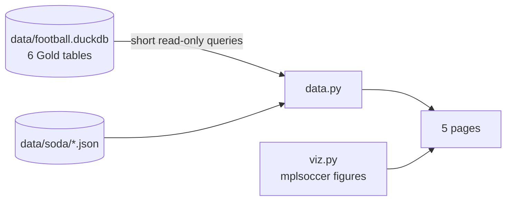

# Dashboard (Streamlit + mplsoccer)

Five pages that read the Gold tables and the last Soda result. Nothing is computed here that Gold does not already hold:
the dashboard only selects, filters and draws, and it opens the data read-only.



## Run it

Needs `make silver` and `make gold` done (`make soda` fills the quality page):

```bash
make app            # builds the image, starts the dashboard: http://localhost:8501
make app-stop       # stops it  (`make down` stops it too)
```

Without Docker: `pip install -r requirements.txt`, then `streamlit run app/streamlit/app.py`. Without any Gold file the
pages say what to run instead of crashing.

## Pages

| Page | Reads | What it shows |
|---|---|---|
| Match overview (`app.py`) | `gold_team_match_stats` | scoreboard, side-by-side team numbers (distance, sprints, top speed, passes and accuracy, shots, goals, tackles, fouls, pressures), average position, how to read the numbers |
| Players | `gold_player_match_stats`, `gold_zone_occupancy`, `gold_player_5min` | pick a team and a player: key numbers, position heatmap (FOO-07), distance and sprint seconds per 5 minutes with the coverage of each window, ranking of the match on any metric |
| Shots and passes | `gold_shots`, `gold_pass_network`, `gold_player_match_stats` | shot map of both teams (stars = goals) with team and goals filters and a table with time, distance to goal and running score; pass network of one team with a minimum-passes slider (FOO-07) |
| Compare matches | `gold_team_match_stats` | two or more matches side by side at team level, one bar chart per metric (FOO-09) |
| Data quality | `data/soda/silver.json`, `gold.json` | passed / failed / warnings / errors of the last `make soda` per layer, and the list of checks (FOO-05) |

The match picker in the sidebar follows you from page to page.

## Reading the graphics

- **Frame.** Every graphic uses the Silver frame: the pitch is 105 x 68 m, **HOME always attacks to the right** and AWAY to
  the left, in both halves. An AWAY player's heatmap therefore looks mirrored compared with a TV picture.
- **Colours.** Team colours are the kit colours of the source. A colour that is too dark for the dark pitch (m001's HOME is
  `#363636`) or two similar colours are replaced by fixed ones (red and blue).
- **Approximate numbers.** Distances, speeds and sprints cover tracked seconds only (about 3/4 of a match) and come from 1 Hz
  positions: they under-estimate real values. Compare players inside one match. Player ids are local to a match, so the
  compare page works on teams, not on players.
- **Credit.** SkillCorner open data, shown on every page.

## Files

| File | Role |
|---|---|
| `app.py`, `pages/*.py` | the pages (Streamlit multipage: the `pages/` folder is the menu) |
| `data.py` | reading Gold (cached for a minute), the match picker, the Soda result reader, shared texts |
| `viz.py` | the figures: zone heatmap, shot map, pass network, ranking bars (pure functions, tested without Streamlit) |
| `Dockerfile`, `requirements.txt` | the image of `make app` (the repository is mounted read-only, nothing is copied in) |

Settings by environment variable: `GOLD_DUCKDB_PATH` (default `data/football.duckdb`), `GOLD_PARQUET_DIR` (read
`<table>.parquet` files from a local folder instead, e.g. a copy of `s3://gold`), `SODA_OUT_DIR`, `APP_PORT` (compose).

The DuckDB file is opened for the time of one query and closed at once: DuckDB allows a single writer, so a connection kept
open by the dashboard would block the next `make gold`.

## Tests

`tests/app/`: every page runs headless (Streamlit `AppTest`) on a real Gold file built by dbt from the tiny fixture, plus the
case "Gold does not exist yet" and the colour rules (`python -m pytest tests/app`). The graphics were also rendered on the real
m001 data and looked at: the shot map shows HOME's 2 goals at the right goal and AWAY's 3 at the left one (final score 2-3),
and the pass network puts AWAY's goalkeeper near x = 100, as expected for a team attacking to the left.

## Not built (yet)

- **Live pitch and live score** (FOO-06): they need the Kafka stream (`foot-tracking`, `foot-events`) and a consumer, not Gold.
  The bonus 3D page and the FastAPI gateway are the other folders of `app/`.
- Clustering of player profiles (FOO-09, optional): only the team-level comparison exists.
- The `app` container and the browser rendering were not run here (no Docker, no browser in the development sandbox): the
  pages were run headless and the figures rendered to images.
