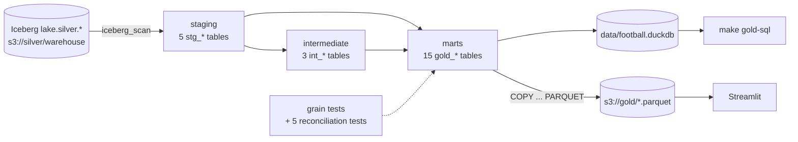

# Gold (dbt + DuckDB)

Silver is clean but still row-level (a player at a second, an action). Gold turns it into the numbers the app and the
report need: distances, sprints, pass networks, shot maps, heatmaps. dbt-core + dbt-duckdb read the Silver Iceberg
tables, build 15 Gold tables, test them against Silver, and export them to the MinIO bucket `gold`.
The specification is [`docs/gold-guide.md`](../docs/gold-guide.md); this folder implements it.



DuckDB is an embedded engine, not a server: there is no DuckDB port to open. It runs inside the `dbt` and `duckdb`
containers and keeps the tables in the file `data/football.duckdb` (git-ignored).

## Run it

Needs the stack (`make up`) and Silver written for the matches (`make silver MATCH="m001 m002"`). Only Docker is needed:

```bash
make gold                                   # dbt build: staging + 15 Gold tables + all tests + Parquet export to s3://gold
make gold ARGS="--select gold_shots"        # one model (+gold_shots also builds its parents)
make gold-sql                               # list the Gold tables with their row counts
make gold-sql Q="select name, distance_km, sprint_count from gold_player_match_stats order by distance_km desc limit 5"
```

The first run builds the image (`dbt/Dockerfile`: dbt-core + dbt-duckdb on Python 3.12) and downloads the DuckDB
extensions `httpfs` and `iceberg` into the `duckdb-ext` volume. A failing test is reported with its name and the
number of failing rows.

**Without Docker for dbt** (development, tests): `pip install -r requirements.txt`, then from `dbt/`:

```bash
DBT_TARGET=minio GOLD_S3_ENDPOINT=localhost:9000 MINIO_ROOT_USER=... MINIO_ROOT_PASSWORD=... \
  dbt build --vars "{export_gold: true}"
```

or on any Silver Parquet files (no MinIO needed; layout `<root>/<table>/*.parquet`, target `dev`):

```bash
dbt build --vars "{silver_reader: parquet, silver_parquet_root: /path/to/silver_parquet}"
```

## Files

| Path | Role |
|---|---|
| `dbt_project.yml` | settings as `vars` (reader, zone grid, 5-minute window, export) and materializations |
| `profiles.yml` | committed, no secret: everything comes from environment variables. Target `dev` (DuckDB only) and `minio` (extensions + S3 settings) |
| `macros/silver_table.sql` | the one place that says how a Silver table is read (`iceberg_scan` or `read_parquet`) |
| `macros/export_gold.sql` | `on-run-end`: copies each Gold table to `<gold_export_root>/<table>.parquet` when `export_gold` is true |
| `models/staging/` | `stg_tracking, stg_events, stg_ball, stg_players, stg_matches`: Silver scanned once, same columns |
| `macros/attack_frame.sql` | `x_att`, `y_att`, thirds and lanes as seen by the team of a row (docs/product.md, section 2) |
| `models/intermediate/` | `int_events` (events + `x_att` + progressive and defensive flags), `int_team_shape_second`, `int_space_control_second` (a Python model: numpy) |
| `models/marts/` | the 15 Gold tables and their `schema.yml` |
| `tests/` | `unique_combination` generic test and five `assert_*` reconciliation tests |
| `scripts/duckdb_query.py` | read-only SQL on the Gold file (behind `make gold-sql`) |
| `Dockerfile` | image shared by the `dbt` and `duckdb` services of `docker-compose.yml` (DuckDB pinned to 2.0, like the Soda and dashboard images) |

Tests of the SQL on a tiny hand-made Silver: `tests/dbt/` (`python -m pytest tests/dbt`).

## The Gold tables

All are rebuilt in full at each run (`table` materialization): two matches take seconds, and a full rebuild can never
leave a stale row. Move to `incremental` (`delete+insert` on `match_id`) if the number of matches grows.

| Table | Grain | What it holds |
|---|---|---|
| `gold_player_match_stats` | player x match | minutes, tracked seconds, `distance_m / distance_km`, `sprint_seconds`, `sprint_count` (efforts), `max_speed_kmh`, `avg_speed_kmh`, `avg_x / avg_y`, passes (total, successful, received), shots, goals, tackles, fouls, pressures (FOO-04) |
| `gold_team_match_stats` | team x match | names, colours, score, distance, sprints, passes and `pass_accuracy`, shots, goals, tackles, fouls, pressures, average position |
| `gold_zone_occupancy` | player x zone x match | grid of 6 x 4 cells in the Silver frame: `zone_id`, cell bounds, `seconds`, `share_of_tracked_seconds` (heatmaps, FOO-07) |
| `gold_pass_network` | passer x receiver x match | `passes`, `passes_successful`, average start and end points, player names (nodes: `avg_x / avg_y` of the player table) |
| `gold_shots` | one shot or goal | position, `is_goal`, `attacking_goal_x`, `distance_to_goal_m`, running score `score_home_after / score_away_after` (shot map, FOO-07) |
| `gold_player_5min` | player x 5-minute window x match | tracked seconds, `coverage`, distance, sprint seconds, max speed, actions (batch twin of the streaming job) |

The MatchLens tables answer the questions of [`docs/product.md`](../docs/product.md) (section 7); their formulas are
there and their columns in [`docs/contrat_donnees.md`](../docs/contrat_donnees.md), section 10.3:

| Table | Grain | Answers |
|---|---|---|
| `gold_match_timeline` | team x 5-minute window x match | F1, F2, F7, E2: field tilt, possession (greyed under 60 known seconds), shots, goals, score, defensive actions, xThreat |
| `gold_player_card` | player x match | F3-F6, F8: dpm, top speed, rates per tracked minute, 5 scores ranked within the match (eligible players only), involvement, hub |
| `gold_team_shape` | team x phase x match | C1, C2: width, length, area, defensive line, detected share |
| `gold_pressing` | team x 15-minute window x match | C3: defensive actions per opponent pass, by third |
| `gold_team_build_up` | team x match | C4, C5: progressive passes, final-third entries by lane |
| `gold_player_fatigue` | player x match | C6: dpm in the first 15 and last 5 minutes on the pitch, drop, eligibility |
| `gold_space_control` | team x 5-minute window x match | S1: share of a 1 m grid nearest to the team, by phase (about 8 s per match) |
| `gold_team_profile` | team x match | C7, F7: whole-match team metrics and the gaps between the two teams |
| `gold_events` | one event, runs included | E1: Silver events + names, `x_att`, `y_att`, third, lane |

Definitions that matter:

- **Distance** = sum of `speed_kmh / 3.6` over tracked seconds. Null speeds (first second after a gap, first row of a
  player) add nothing. 1 Hz chords cut corners: it is an under-estimate.
- **Sprint effort** = a run of consecutive sprint seconds (> 25 km/h) counts once; a missing second ends the run.
  `sprint_seconds` is kept next to it.
- **Successful pass** = `outcome = 'successful'` (the source also has `unsuccessful` and `offside`).
- **`shots` counts type `shot` only**; goals are separate. The shot map is `gold_shots` (shots + goals).
- **Frame**: HOME attacks toward x = 105, AWAY toward x = 0 (Silver mirrors AWAY events). The goal a team attacks is at
  x = 105 for HOME and x = 0 for AWAY, centre y = 34.
- **Only tracked time**: about 73 % to 78 % of the seconds exist. Say it wherever a distance or a heatmap is shown.

## How Silver is read

`macros/silver_table.sql`, variable `silver_reader`:

| Value | SQL | Use |
|---|---|---|
| `iceberg` (default) | `iceberg_scan('s3://silver/warehouse/silver/<table>')` | the real stack: Hadoop-catalog folders written by `spark/silver`; `unsafe_enable_version_guessing` is set in the `minio` target |
| `parquet` | `read_parquet('<silver_parquet_root>/<table>/*.parquet')` | fallback if DuckDB cannot read the Iceberg folders, and the tests |

Staging models are tables, so the Iceberg folders are scanned once per run, not once per Gold model.

## Tests

- **Grain and vocabularies** (`schema.yml`): one row per key on every table (`unique_combination`), `not_null`,
  `accepted_values` (`HOME` / `AWAY`, event types, `shot` / `goal`), `relationships` to players and matches.
- **Reconciliation with Silver** (`tests/assert_*.sql`), without any hard-coded number: row counts per match (players,
  2 teams, shots) · goals in `gold_shots` and the final running score equal the score of `silver.matches` · passes,
  received passes and tracked seconds are the same in the player, team, network, zone and 5-minute tables as in Silver ·
  passer and receiver are in the same team · no negative distance, no speed above 40 km/h, no more sprint efforts than
  sprint seconds.

Checked on m001 (re-converted from SkillCorner 1874553), Silver Parquet then the whole dbt chain: **26** shot rows
(21 shots + 5 goals), running score ending **2-3**, **32** player rows, **837** passes (all with a receiver, 700
successful), 2 team rows. Distance and sprint efforts were also recomputed independently with pandas: identical.
The "m002" delivered in the zip (SkillCorner 1927964, score 4-1) passes all tests too.

## Decisions taken

1. **Silver read: Iceberg directly, Parquet as a switch** (decision 2 of the guide). The switch costs one variable.
2. **Zone grid 6 x 4** (17.5 m x 17 m cells) in the Silver frame, so AWAY cells are seen from HOME's side. Change
   `zones_x / zones_y` in `dbt_project.yml`; mirror once more in the app for a team-relative view.
3. **DuckDB file and Parquet export both**: `data/football.duckdb` for queries, `s3://gold/<table>.parquet` for the app.
4. **Full rebuild instead of incremental** (see above).
5. Pass success from the profiled `outcome` values; sprint count and sprint seconds are both kept.

## Not verified yet

- The **containers** (`dbt`, `duckdb`) and the **MinIO export** were not run here: no Docker in the development sandbox.
  The `minio` target of `profiles.yml` parses, and the same models, tests and macros ran on local Parquet.
- **`iceberg_scan` on a Hadoop-catalog folder on MinIO** is the known risk (guide, section 3). If `make gold` fails on a
  `stg_*` model: check that `make silver` wrote `s3://silver/warehouse/silver/<table>/metadata/`, then that the `iceberg`
  extension installed (internet access of the container, `duckdb-ext` volume). If DuckDB still cannot read it, use
  `silver_reader: parquet` and add a Parquet export step to Silver (to be done on request).

## Troubleshooting

- `Table with name ... does not exist` in a `stg_*` model: Silver is empty for that table, run `make silver`.
- `IO Error ... Connection refused` or `403`: wrong `GOLD_S3_ENDPOINT` (must be `minio:9000`, no `http://`) or MinIO
  password; see `.env`.
- `Could not set lock on file` on `data/football.duckdb`: another process holds the file for writing; DuckDB allows one
  writer. `make gold-sql` only opens it read-only.
- A reconciliation test fails: its output lists the failing rows. `assert_goals_equal_score` usually means Silver and the
  ingestion manifest disagree (an own goal, a scorer outside the lineup): read the Silver report first.
- Files created by the containers belong to root (the repository is mounted in `/app`):
  `sudo chown -R $USER data dbt/target dbt/logs`.
