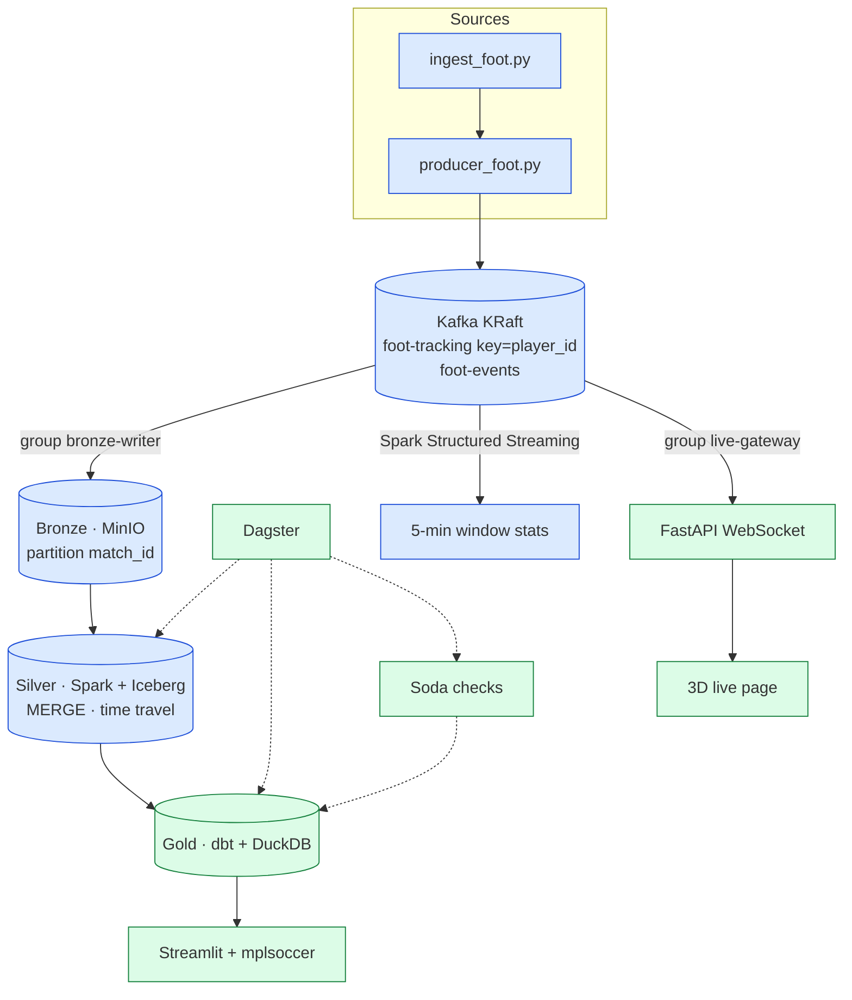

# Architecture

## Two paths, three layers
- **Batch path** (Dagster): Bronze → Silver → Gold, for post-match analytics.
- **Stream path**: Kafka → live display (and optional Spark Structured Streaming 5-min stats).

Blue = Person A · Green = Person B.

## Conventions
- Pitch 105 × 68 m, origin bottom-left, metres.
- Kafka key = `player_id` → ordering per player.
- Buckets: `bronze`, `silver`, `warehouse`.

## Memory budget (16 GB laptop)
| Service | Limit |
|---|---|
| Kafka | 1 GB |
| Kafka UI | 0.5 GB |
| MinIO | 0.5 GB |
| Spark (local mode) | ~3 GB |
| Dagster (web + daemon + db) | ~1.5 GB |
| Streamlit / API / web3d | ~1 GB |

Run the streaming job only when demonstrating it.

## Tool justification (for the report)
| Tool | Problem solved that others don't |
|---|---|
| Kafka | ordered per-player stream, replay, several independent consumer groups |
| MinIO | S3-compatible storage for raw files and Iceberg |
| Iceberg | MERGE for corrections, time travel, schema evolution |
| dbt | SQL models + tests + docs + lineage |
| Soda | production data-quality checks that can block the pipeline |
| Dagster | scheduling, retries, run history, asset checks |
| mplsoccer | football pitch drawing |
