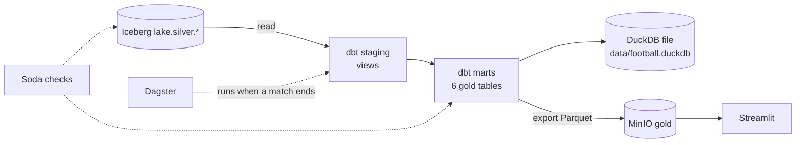

# Gold guide (FOO-04, FOO-07, FOO-09)

**Status: planned, nothing is implemented.** This guide is the specification for the Gold layer (dbt + DuckDB),
written from [`architecture.md`](architecture.md), section 6 of [`silver-guide.md`](silver-guide.md), the Silver
job ([`spark/silver/README.md`](../spark/silver/README.md)) and what was measured on m001. Where a choice is not
settled it is listed in section 10: decide those first.

## 1. Role of Gold

Silver is clean but still row-level (a player at a second, an action). Gold answers questions: how far did a player
run, who passed to whom, where were the shots, how does HOME compare with AWAY or m001 with m002. Gold tables are
small, one row per business grain, and read by Streamlit (FOO-06, FOO-07, FOO-09), Soda and the post-match report.



## 2. What Gold receives (Silver contract)

| Table | Grain | Columns |
|---|---|---|
| `silver.tracking` | player x second, tracked seconds only | `match_id, player_id, team_id, period, ts, x, y, speed_kmh, is_sprint, was_corrected, is_after_gap` |
| `silver.events` | one action | `match_id, event_id, ts, period, player_id, receiver_id, team_id, type, x_start, y_start, x_end, y_end, outcome` |
| `silver.ball` | second | `match_id, ts, period, x, y, z` |
| `silver.players` | player of a match | `match_id, player_id, team_id, name, short_name, position, shirt_number, start_ts, end_ts` |
| `silver.matches` | match | the `matches` columns of the data contract (names, colours, score, periods, sides) |

Facts Gold must respect (all measured, see the Silver and data docs):

- **Always group by (match_id, player_id).** `H01` of m001 and `H01` of m002 are different people.
- **Gaps.** Only about 73% to 78% of the seconds exist. Every distance, sprint and zone figure covers tracked time only.
  Say it in the report and in the app. Never fill a missing second.
- **Speed is a 1-second chord** (1 Hz sampling): peaks and distance are under-estimated. Label them approximate.
  `speed_kmh` is null on the first tracked second after a gap and on a player's first row: these rows add nothing to distance.
- **Frame.** In Silver tracking, HOME attacks toward x = 105 and AWAY toward x = 0, in both halves. Events follow the
  same frame only if decision 1 of section 10 is "per_team" (see the Silver README). Gold shot formulas below assume it.
- **Shots.** A shot map is `type in ('shot', 'goal')`. The source gives no saved / blocked / off-target outcome.
- **Names are real** and kit colours are in `silver.matches`; technical keys stay `H01` / `HOME`. Credit SkillCorner.

## 3. How Gold reads Silver

dbt-core + dbt-duckdb (the folder `dbt/` already has `dbt_project.yml` and `profiles.yml.example`). Two options:

| Option | How | Risk |
|---|---|---|
| A. Read Iceberg directly | DuckDB `httpfs` + `iceberg` extensions, `iceberg_scan` on the table folders in `s3://silver/warehouse/silver/<table>` (Hadoop catalog: metadata JSON + `version-hint.text`) | DuckDB support for a Hadoop catalog on MinIO must be tested first (spike of half a day) |
| B. Parquet mirror (fallback named in `dbt/README.md`) | a small Spark step copies each Silver table to `s3://silver/export/<table>/` as Parquet; DuckDB reads those files | one more step to keep in sync, one more Dagster asset |

Do the spike with A first; switch to B as soon as A needs more than the spike. Staging models hide the choice:
`stg_tracking`, `stg_events`, `stg_ball`, `stg_players`, `stg_matches` are views that select from the source, so marts
never change when the source changes. Put the S3 settings in `profiles.yml` (from `.env`, never committed).

## 4. Gold tables

Every model documents its grain and key in `schema.yml`. All use `match_id` so a match can be recomputed alone
(`incremental`, `delete+insert` on `match_id`; a full refresh is cheap: two matches).

### 4.1 `gold_player_match_stats`: player x match (FOO-04)

Key (match_id, player_id). Columns:

| Column | Definition |
|---|---|
| `team_id, name, short_name, position, shirt_number` | from `silver.players` |
| `minutes_on_pitch` | (end_ts - start_ts) / 60 |
| `tracked_seconds` | rows of `silver.tracking` |
| `distance_m` | sum of `speed_kmh / 3.6` over tracked seconds (nulls skipped); also `distance_km` |
| `sprint_seconds` | tracked seconds with `is_sprint` |
| `sprint_count` | sprint efforts: consecutive sprint seconds count as one |
| `max_speed_kmh`, `avg_speed_kmh` | max and mean of `speed_kmh` (nulls skipped) |
| `avg_x`, `avg_y` | mean position (node position for the pass network) |
| `passes, passes_successful, passes_received, shots, goals, tackles, fouls, pressures` | counts from `silver.events` (`passes_received` = rows where `receiver_id` is the player). `shots` counts `type = 'shot'` only, `goals` counts `goal`; shots on the shot map = shots + goals |

```sql
-- sprint efforts: a sprint second that does not continue the previous second starts one effort
with t as (
  select *, lag(is_sprint) over w as prev_sprint, lag(ts) over w as prev_ts
  from {{ ref('stg_tracking') }}
  window w as (partition by match_id, player_id order by ts)
)
select match_id, player_id,
       sum(speed_kmh / 3.6)                                   as distance_m,
       count(*) filter (where is_sprint)                      as sprint_seconds,
       count(*) filter (where is_sprint
                        and not (coalesce(prev_sprint, false) and ts - prev_ts = 1)) as sprint_count,
       max(speed_kmh)                                         as max_speed_kmh
from t group by 1, 2
```
Pass success: profile first (`select outcome, count(*) from silver.events where type = 'pass' group by 1`); the data
contract says `outcome` is copied from the source (e.g. `successful`). Define `passes_successful` from that list and
write the list in `schema.yml` (`accepted_values`).

### 4.2 `gold_team_match_stats`: team x match

Key (match_id, team_id). Team names, short names, colours and final score from `silver.matches`; then sums of the player
table: `distance_km`, `sprint_count`, `passes`, `passes_successful`, `pass_accuracy`, `shots`, `goals`, `tackles`,
`fouls`, `pressures`, plus `avg_x` of the team. Possession is not available in the source, do not invent it.

### 4.3 `gold_zone_occupancy`: player x zone (x match)

Key (match_id, player_id, zone_id). A grid over the pitch in the Silver frame (proposal: 6 columns x 4 rows, cells
17.5 m x 17 m, `zone_id = row * 6 + col`). Columns: `zone_x, zone_y, seconds, share_of_tracked_seconds`.
`zone_x = least(floor(x / 105 * 6), 5)` so that x = 105 (clipped rows) stays in the last cell. Heatmaps in the app can
use this table or `silver.tracking` directly with mplsoccer bins. The grid size is decision 3 of section 10.

### 4.4 `gold_pass_network`: passer x receiver x match

Key (match_id, passer_id, receiver_id). From `silver.events` where `type = 'pass'` and `receiver_id` is not null:
`team_id, passes, passes_successful, avg_start_x, avg_start_y, avg_end_x, avg_end_y`. Node positions come from
`gold_player_match_stats.avg_x / avg_y`. Add a test that `passer_id` and `receiver_id` belong to the same team.

### 4.5 `gold_shots`: one shot

Key `event_id`. `silver.events` where `type in ('shot', 'goal')`: `match_id, ts, period, player_id, team_id, type,
is_goal, x_start, y_start, x_end, y_end`, plus:

- `attacking_goal_x` = 105 for HOME, 0 for AWAY (needs decision 1 = "per_team"), goal centre y = 34;
- `distance_to_goal_m` = hypot(x_start - attacking_goal_x, y_start - 34);
- `score_home_after`, `score_away_after`: running count of goals up to and including the row (window on `ts`), used by
  the live score and the shot timeline.

Names come from a join on `silver.players`; kit colours from `silver.matches`.

### 4.6 `gold_player_5min`: player x 5-minute window

Key (match_id, player_id, window_start_ts). `window_start_ts = floor(ts / 300) * 300` on the match clock (`ts`, not
wall time). Columns: `window_end_ts, tracked_seconds, distance_m, sprint_seconds, max_speed_kmh`, and the counts of
actions by type. A window with few tracked seconds is flagged (`coverage = tracked_seconds / 300`). This is the batch
twin of the optional streaming job of FOO-08 (the streaming job builds `event_time = kick-off + ts` itself).

## 5. dbt layout

```
dbt/
  dbt_project.yml          # exists: staging = view, marts = table (switch gold models to incremental)
  profiles.yml.example     # exists: DuckDB file + commented extensions
  packages.yml             # dbt_utils (unique_combination_of_columns)
  models/staging/          # stg_tracking, stg_events, stg_ball, stg_players, stg_matches + sources.yml
  models/marts/            # the 6 gold_* models + schema.yml (grain, tests, descriptions)
  tests/                   # singular tests (section 6)
```

Tests in `schema.yml`: `not_null` and key uniqueness (`unique_combination_of_columns`) on every grain,
`relationships` (player in `stg_players`, match in `stg_matches`), `accepted_values` on `type`, `team_id`, `outcome`.
`dbt docs generate` gives the lineage for the report. Export the marts to `s3://gold/<table>/` as Parquet (DuckDB
`COPY ... TO`, in a post-hook or a dbt-duckdb `external` model): decision 4.

## 6. Checks

**Soda (FOO-05, owner of `soda/`: ingestion side).** On Silver: 22 tracking rows for every existing second of a match,
`x` in [0, 105] and `y` in [0, 68] on `silver.tracking` (the ball and events are not clipped on purpose), `speed_kmh <= 40`
(nulls allowed), event types in {pass, shot, goal, tackle, foul, pressure}, goals in events = home_score + away_score,
row counts per table (m001: 97,416 / 1,741 / 4,428 / 32 / 1). On Gold: the checks below as `row_count` and
`failed rows`. Demonstrate one failure on purpose (the brief asks for it).

**Reconciliation tests in dbt (singular tests)**, expected values for m001:

| Test | Expected |
|---|---|
| `gold_shots` rows | 26 (21 shots + 5 goals); goals = 5; final `score_home_after`, `score_away_after` = 2, 3 |
| `gold_player_match_stats` rows | 32 (the players who were on the pitch, = rows of `silver.players`) |
| sum of `passes` over players = `count(*)` of passes in `silver.events` | 837 |
| sum of `goals` over teams = `home_score + away_score` | 5 |
| `gold_team_match_stats` rows | 2 |
| a player's `distance_m` is 0 or more and his `max_speed_kmh` <= 40 | all rows |

The m002 values come from your own run (the guide gives: 1 goal, 0-1).

## 7. Dagster

Assets in order: bronze (exists as `bronze_writer`) -> `silver` (runs `python -m spark.silver.bronze_to_silver --match <id>`)
-> `dbt` (`dagster-dbt`, the 6 gold models) -> Soda asset checks (a failed check blocks what follows) -> post-match report.
Sensor: the match is over when the largest `ts` of the match in bronze reaches `matches.p2_end_ts`; it triggers Silver, then
Gold, then the report. The Silver job is idempotent (it replaces the match partition) and so are the incremental Gold models,
so retries and re-runs are safe. At least one schedule, retries on the Spark and dbt steps (see `dagster/README.md`).

## 8. Streamlit (consumers)

| Page | Reads | Requirement |
|---|---|---|
| Live match (22 dots, score) | Kafka `foot-tracking` / `foot-events`, or `silver.tracking` for the replay; the score from `gold_shots` or a count of `goal` events up to the current `ts` | FOO-06 |
| Player (heatmap, key numbers) | `gold_zone_occupancy` or `silver.tracking`, `gold_player_match_stats` | FOO-07 |
| Shots and passes | `gold_shots`, `gold_pass_network`, `gold_player_match_stats` (nodes) | FOO-07 |
| Teams, HOME vs AWAY, m001 vs m002 | `gold_team_match_stats` | FOO-09 |

Compare matches at team level only: player ids are match-local, so a player-level comparison between m001 and m002
needs a persistent player id (listed as a possible extension in the README).

## 9. Build order and definition of done

1. Decide the points of section 10. 2. Spike: DuckDB reading Silver (option A or B). 3. Staging models and
`sources.yml`. 4. `gold_player_match_stats` (FOO-04) and its reconciliation tests. 5. `gold_team_match_stats`,
`gold_shots`, `gold_pass_network`. 6. `gold_zone_occupancy`, `gold_player_5min`. 7. Parquet export to `s3://gold`.
8. Soda and Dagster wiring. 9. Update `docs/requirements-coverage.md` with a proof for each requirement.

Done = `dbt build` passes on m001 and m002, the m001 reconciliation table above holds, the Gold tables are in the
`gold` bucket, the docs say where the tables are and what their limits are.

## 10. Open decisions (answer before building)

| # | Decision | Proposal |
|---|---|---|
| 1 | Events direction in Silver: `guide` (literal) or `per_team` (mirror AWAY only). Shot maps and `gold_shots` depend on it | `per_team`: measured on m001, it puts events about 1 m from the player's own tracking position (the literal rule leaves 54 to 58 m for half of the groups) |
| 2 | Read Silver: Iceberg directly (A) or Parquet mirror (B) | spike A, fall back to B |
| 3 | Zone grid for `gold_zone_occupancy` | 6 x 4 cells in the Silver frame; for AWAY, mirror once more if a team-relative view is wanted |
| 4 | Where Gold lives: DuckDB file only, or also Parquet in `s3://gold` | both (the architecture names the `gold` bucket) |
| 5 | Definition of a successful pass | from the profiled `outcome` list of `silver.events` |
| 6 | Sprint count: efforts (consecutive seconds = one) or sprint seconds | store both (4.1 does) |
