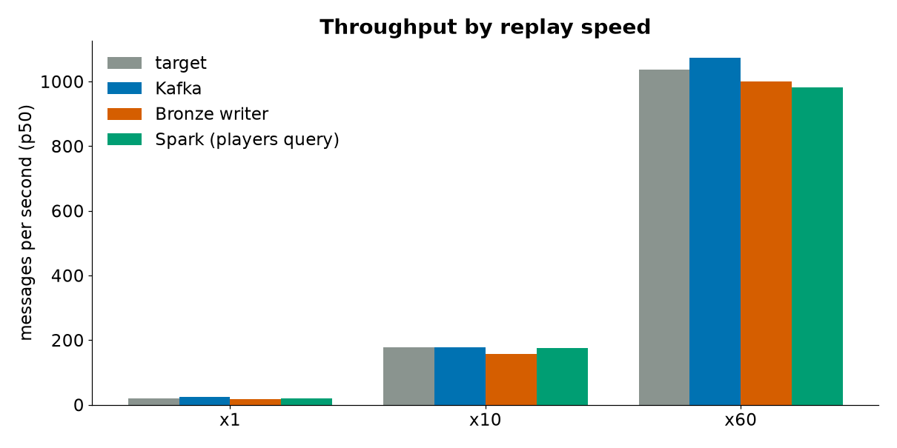
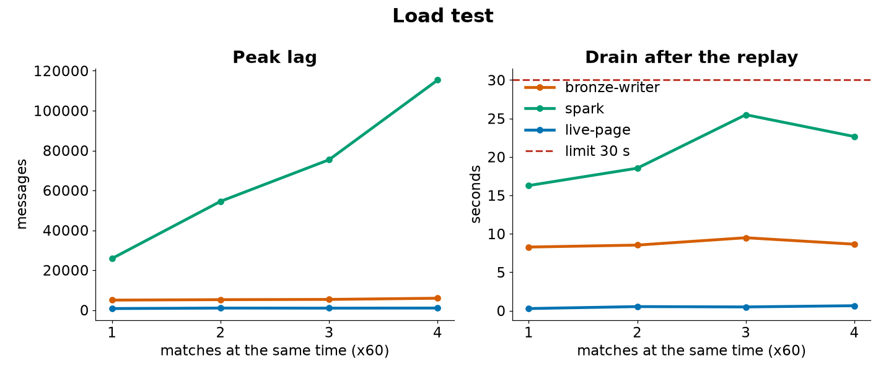

# Performance of the platform

Generated by `make benchmark` on 2026-11-17 14:32 UTC, commit `d5c7ce4`. Do not edit: run `make benchmark` to measure again, `make benchmark-report` to rebuild this page from the last results (`data/benchmark/2026-11-17T143211Z.json`).

Machine: AMD Ryzen 5 7530U with Radeon Graphics, 12 threads, 14 GiB of memory, everything on one laptop (Docker). Percentiles are nearest-rank over every measured value: p95 = 95 % of the values are at or below it.

## Service level objectives

| Objective | Measured | Result |
|---|---|---|
| Live delay p95 < 2 s | 0.49 s (x1) | PASS |
| Freshness < 10 min | 14.7 min | FAIL |
| Run success >= 95 % | 88.0% (all runs: 88.2%) | FAIL |

Run success counts the normal runs only; runs started on purpose for tests (tag `purpose`: the damaged-data demo, the benchmark rebuild) are left out, and the rate of all runs is shown next to it.

## Bottlenecks

- **Spark Structured Streaming batches** take 11.2 s (p50, p95 17.0 s) for a 5 s trigger, sampled while the replays ran: each batch starts late, so the 5-minute statistics arrive later than the trigger suggests.
- **The app's own consumer** is slower than the probe running the same code at x1: p95 2,925 ms against 492 ms. The app measures its lag inside its read loop (`live_feed._lag`, every 5 s, one broker round trip per partition): reading waits meanwhile. The probe did the same before it was changed and lost about 1.8 s per measure.
- **Slowest reader**: spark, 22.7 s to drain at 4 matches (peak lag 115,346 messages), against bronze-writer 8.6 s, live-page 0.6 s.
- **CPU at the highest load level** (cores, p95): spark-worker 2.84, kafka 1.00, streaming-5min 0.88.
- **After the final whistle**, the longest step is `silver` (787 s of 867 s).
- **Silver reads every replay kept in Bronze**: for m001, 27 copies, 2,002,066 tracking rows read to keep 97,416. Bronze only grows (each replay adds a copy), so Silver gets slower with every replay of a match, the benchmark's own replays included.

## 1. Throughput

Rows per second, sampled every 15 s while the replay ran (Prometheus). Target: the rows the match contains per second of play, times the speed.

| Speed | Match, seconds measured | Target msg/s | Kafka msg/s p50 · p95 · p99 | Bronze writer rows/s p50 · p95 · p99 | Spark rows/s (players query) p50 · p95 · p99 |
|---|---|---|---|---|---|
| x1 | m002, 361 s | 20 | 23 · 24 · 24 | 17 · 35 · 35 | 21 · 33 · 46 |
| x10 | m003, 361 s | 178 | 179 · 232 · 234 | 158 · 281 · 286 | 175 · 226 · 277 |
| x60 | m001, 101 s | 1,037 | 1,073 · 1,141 · 1,141 | 1,000 · 1,000 · 1,000 | 982 · 1,121 · 1,121 |

## 2. Latency

**Producer → Kafka → Live page state**: a consumer running the Live page's own code (`live.route`) measures, for every message, the time from the producer's send (Kafka timestamp) to the state updated. The app's own histogram (Prometheus, approximate: buckets) is the cross-check.
**Producer → window complete**: from the send of the first tracking message past a window's end (+10 s of grace) to the first `foot-live-stats` row of that window marked complete.

| Speed | Messages | Live p50 · p95 · p99 · max (ms) | App histogram p95 (ms) | Windows | Window complete p50 · p95 · p99 (s) |
|---|---|---|---|---|---|
| x1 | 7,096 | 297 · 492 · 529 · 592 | 2,925 | 2 | 14.9 · 24.1 · 24.1 |
| x10 | 64,253 | 282 · 508 · 529 · 1,161 | 740 | 17 | 14.8 · 21.9 · 21.9 |
| x60 | 104,153 | 300 · 531 · 558 · 614 | 713 | 26 | 12.9 · 19.0 · 19.1 |

**Final whistle → Gold ready** (m001 at x60, run `a52c948b`): 881 s, the Data quality page's rule (start of the run → end of the `gold` step). Each step, with its CPU and peak memory (containers `dagster-daemon` and `spark-worker`, where the Spark driver, its executor and dbt run):

| Step | Duration (s) | CPU-seconds | Peak memory (MiB) | Before the run (MiB) |
|---|---|---|---|---|
| `bronze` | 14.0 | – | 2,475 | 2,773 |
| `silver` | 787.2 | 573.4 | 4,912 | 2,773 |
| `silver_soda_silver` | 3.2 | – | 2,963 | 2,773 |
| `gold` | 58.2 | 95.1 | 2,963 | 2,773 |
| `soda_gold` | 3.6 | – | 2,495 | 2,773 |
| `match_report` | 1.2 | – | 2,495 | 2,773 |

CPU-seconds are left out for steps under 30 s: Prometheus reads the counters every 15 s, too coarse to separate them. Memory is the two containers together; the last column is their memory just before the run (the daemon and the idle Spark worker).

## 3. Resources

Silver for one match (steps `silver` + `silver_soda_silver`): 573 CPU-seconds, peak 4,912 MiB. Gold (steps `gold` + `soda_gold`): 95 CPU-seconds, peak 2,963 MiB.

Peak memory of the whole stack during the benchmark: **8,802 MiB** (every container, the monitoring included), of 14 GiB.

## 4. Load test

1, 2, 3 then 4 different matches replayed at the same time at x60, the Dagster replay sensor paused (no pipeline run in between). Drain = seconds after the producers stop until the reader has read everything; a reader is over the limit when its lag keeps growing or it needs more than 30 s.

| Matches | Achieved / target msg/s | Live p95 (ms) | Host CPU p95 | Min. free memory | Drain: bronze-writer · spark · live page (s) | Lag growing |
|---|---|---|---|---|---|---|
| 1 | 1,029 / 1,037 | 530 | 49 % | 3,662 MiB | 8 · 16 · 0 | no |
| 2 | 2,111 / 2,140 | 486 | 56 % | 3,202 MiB | 9 · 19 · 1 | no |
| 3 | 3,121 / 3,214 | 391 | 84 % | 2,855 MiB | 9 · 25 · 0 | no |
| 4 | 4,130 / 4,283 | 295 | 72 % | 3,003 MiB | 9 · 23 · 1 | no |

**Limit on this laptop: not reached at 4 matches at x60.**

## 5. Reliability

Dagster runs of the last 7 days: 34, success 88.0% without the runs started on purpose for tests (9), 88.2% for all. Step retries used: 2 (in 1 run; Silver and Gold retry twice, 30 s apart).

Recovery: a service restarted in the middle of a replay at x10. Back to normal = its lag at or under the highest lag of the minute before the restart, for 10 s.

| Service restarted | Lag before (max) | Lag peak after | Back to normal after |
|---|---|---|---|
| bronze-writer | 2,328 | 9,400 | 47 s |
| spark-streaming | 4,070 | 12,144 | 20 s |

After the benchmark, Gold was rebuilt once for the matches of the load test (m001, m002, m003, m004): freshness green on every match: yes; GoldStale alert firing: no.

## Limits of this benchmark

- One laptop runs everything (Kafka, Spark, Dagster, the app, the monitoring, the producers and this script): the components compete for the same CPU and memory.
- x1 and x10 measure a 6-minute slice of a match, not the whole match.
- The Live page latency is measured by a consumer running the page's code on the host, not inside the app container; the app's histogram is the cross-check.
- CPU and memory per step belong to the containers where the step runs, other work included (the daemon's sensors, the idle worker).
