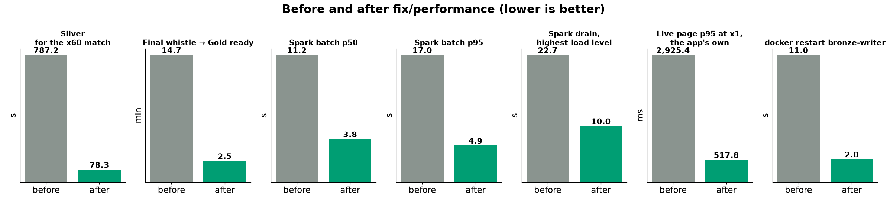
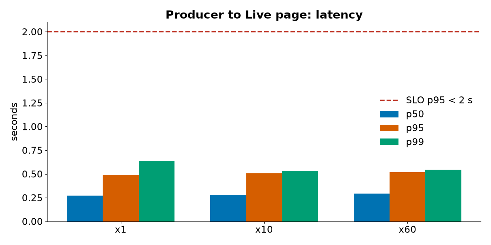
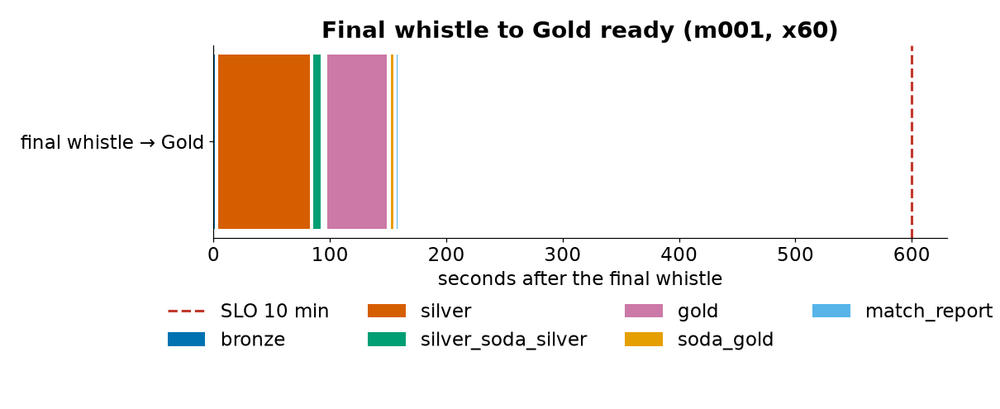

# Performance of the platform

Generated by `make benchmark` on 2026-11-17 23:41 UTC, commit `83a20b8`. Do not edit: run `make benchmark` to measure again, `make benchmark-report` to rebuild this page from the last results (`data/benchmark/2026-11-17T234104Z.json`).

Machine: AMD Ryzen 5 7530U with Radeon Graphics, 12 threads, 14 GiB of memory, everything on one laptop (Docker). Percentiles are nearest-rank over every measured value: p95 = 95 % of the values are at or below it.

## Service level objectives

| Objective | Measured | Result |
|---|---|---|
| Live delay p95 < 2 s | 0.49 s (x1) | PASS |
| Freshness < 10 min | 2.5 min | PASS |
| Run success >= 95 % | 90.9% over 7 days (all runs: 90.2%); 96.2% since the last fix (`0d3c37a`, 26 runs) | FAIL |

## Before and after fix/performance

Before: `data/benchmark/2026-11-17T143211Z.json` (commit `d5c7ce4`, 2026-11-17 14:32 UTC). After: this run. What changed: Silver reads only the latest complete replay; Spark streaming has 2 cores (the worker 4) and 2 shuffle partitions; the Live page measures its lag outside its read loop; bronze-writer stops cleanly on SIGTERM; test runs are tagged.

| Item | Before | After |
|---|---|---|
| Silver for the x60 match | 787.2 s | 78.3 s |
| Final whistle → Gold ready | 14.7 min | 2.5 min |
| Bronze copies Silver read | 27 | 1 |
| Spark batch p50 | 11.2 s | 3.8 s |
| Spark batch p95 | 17.0 s | 4.9 s |
| Spark drain, highest load level | 22.7 s | 10.0 s |
| Live page p95 at x1, the app's own | 2,925 ms | 518 ms |
| Live page p95 at x1, probe (same code) | 492 ms | 489 ms |
| docker restart bronze-writer | 11.0 s | 2.0 s |
| Run success, normal runs, 7 days | 88.0 % | 90.9 % |
| Run success since the last fix | – | 96.2 % |

The restart times of the run before come from its log (whole seconds); the copies Silver read come from Silver's own report of that run.

Run success counts the normal runs only; runs started on purpose for tests (tag `purpose`: the damaged-data demo, the benchmark rebuild) are left out, and the rate of all runs is shown next to it.

## Bottlenecks

- **Slowest reader**: spark, 10.0 s to drain at 4 matches (peak lag 40,814 messages), against bronze-writer 8.0 s, live-page 1.0 s.
- **CPU at the highest load level** (cores, p95): spark-worker 3.67, streaming-5min 1.00, kafka 0.63.
- **After the final whistle**, the longest step is `silver` (78 s of 139 s).

## 1. Throughput

Rows per second, sampled every 15 s while the replay ran (Prometheus). Target: the rows the match contains per second of play, times the speed.

| Speed | Match, seconds measured | Target msg/s | Kafka msg/s p50 · p95 · p99 | Bronze writer rows/s p50 · p95 · p99 | Spark rows/s (players query) p50 · p95 · p99 |
|---|---|---|---|---|---|
| x1 | m002, 361 s | 20 | 24 · 24 · 24 | 17 · 35 · 35 | 23 · 29 · 40 |
| x10 | m003, 361 s | 178 | 180 · 232 · 235 | 159 · 242 · 265 | 228 · 296 · 317 |
| x60 | m001, 101 s | 1,037 | 1,078 · 1,135 · 1,135 | 1,000 · 1,000 · 1,000 | 1,325 · 1,573 · 1,573 |

## 2. Latency

**Producer → Kafka → Live page state**: a consumer running the Live page's own code (`live.route`) measures, for every message, the time from the producer's send (Kafka timestamp) to the state updated. The app's own histogram (Prometheus, approximate: buckets) is the cross-check.
**Producer → window complete**: from the send of the first tracking message past a window's end (+10 s of grace) to the first `foot-live-stats` row of that window marked complete.

| Speed | Messages | Live p50 · p95 · p99 · max (ms) | App histogram p95 (ms) | Windows | Window complete p50 · p95 · p99 (s) |
|---|---|---|---|---|---|
| x1 | 7,096 | 272 · 489 · 640 · 1,218 | 518 | 2 | 8.7 · 8.9 · 8.9 |
| x10 | 64,253 | 279 · 505 · 526 · 629 | 537 | 17 | 4.1 · 7.7 · 7.7 |
| x60 | 104,153 | 293 · 518 · 545 · 593 | 620 | 26 | 4.9 · 8.7 · 9.1 |

**Final whistle → Gold ready** (m001 at x60, run `65ab97f8`): 149 s, the Data quality page's rule (start of the run → end of the `gold` step). Each step, with its CPU and peak memory (containers `dagster-daemon` and `spark-worker`, where the Spark driver, its executor and dbt run):

| Step | Duration (s) | CPU-seconds | Peak memory (MiB) | Before the run (MiB) |
|---|---|---|---|---|
| `bronze` | 0.8 | – | 2,013 | 2,001 |
| `silver` | 78.3 | 236.5 | 4,590 | 2,001 |
| `silver_soda_silver` | 6.4 | – | 4,590 | 2,001 |
| `gold` | 51.1 | 77.3 | 4,013 | 2,001 |
| `soda_gold` | 1.9 | – | 3,287 | 2,001 |
| `match_report` | 0.6 | – | 3,287 | 2,001 |

CPU-seconds are left out for steps under 30 s: Prometheus reads the counters every 15 s, too coarse to separate them. Memory is the two containers together; the last column is their memory just before the run (the daemon and the idle Spark worker).

## 3. Resources

Silver for one match (steps `silver` + `silver_soda_silver`): 236 CPU-seconds, peak 4,590 MiB. Gold (steps `gold` + `soda_gold`): 77 CPU-seconds, peak 4,013 MiB.

Peak memory of the whole stack during the benchmark: **8,346 MiB** (every container, the monitoring included), of 14 GiB.

## 4. Load test

1, 2, 3 then 4 different matches replayed at the same time at x60, the Dagster replay sensor paused (no pipeline run in between). Drain = seconds after the producers stop until the reader has read everything; a reader is over the limit when its lag keeps growing or it needs more than 30 s.

| Matches | Achieved / target msg/s | Live p95 (ms) | Host CPU p95 | Min. free memory | Drain: bronze-writer · spark · live page (s) | Lag growing |
|---|---|---|---|---|---|---|
| 1 | 1,030 / 1,037 | 522 | 58 % | 4,141 MiB | 8 · 8 · 1 | no |
| 2 | 2,113 / 2,140 | 486 | 64 % | 3,805 MiB | 9 · 10 · 1 | no |
| 3 | 3,121 / 3,214 | 381 | 64 % | 3,528 MiB | 10 · 6 · 0 | no |
| 4 | 4,122 / 4,283 | 304 | 85 % | 2,883 MiB | 8 · 10 · 1 | no |

**Limit on this laptop: not reached at 4 matches at x60.**

## 5. Reliability

Dagster runs of the last 7 days: 51, success 90.9% without the runs started on purpose for tests (18), 90.2% for all. Step retries used: 2 (in 1 run; Silver and Gold retry twice, 30 s apart).

Recovery: a service restarted in the middle of a replay at x10. Back to normal = its lag at or under the highest lag of the minute before the restart, for 10 s.

| Service restarted | Lag before (max) | Lag peak after | Back to normal after |
|---|---|---|---|
| bronze-writer | 2,236 | 2,349 | 12 s |
| spark-streaming | 1,848 | 5,566 | 41 s |

After the benchmark, Gold was rebuilt once for the matches of the load test (m001, m002, m003, m004): freshness green on every match: yes; GoldStale alert firing: no.

## Limits of this benchmark

- One laptop runs everything (Kafka, Spark, Dagster, the app, the monitoring, the producers and this script): the components compete for the same CPU and memory.
- x1 and x10 measure a 6-minute slice of a match, not the whole match.
- The Live page latency is measured by a consumer running the page's code on the host, not inside the app container; the app's histogram is the cross-check.
- CPU and memory per step belong to the containers where the step runs, other work included (the daemon's sensors, the idle worker).
