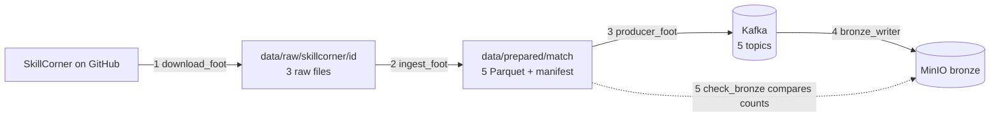

# Ingestion

Everything between the SkillCorner open data and the bronze layer in MinIO: five scripts, run in order.
Steps 1 and 2 need no Docker. Steps 3 to 5 need the stack (`make up`).



## The files

| Step | File | What it does | Reads | Writes | Docker |
|---|---|---|---|---|---|
| 1 | `download_foot.py` | downloads the raw files of a match | GitHub | `data/raw/skillcorner/<id>/` | no |
| 2 | `ingest_foot.py` | converts them into our five tables and a manifest | the raw files | `data/prepared/<match>/` | no |
| 3 | `producer_foot.py` | replays the match into Kafka, speed x1 to x60 | `data/prepared/<match>/` | 5 Kafka topics | yes |
| 4 | `bronze_writer.py` | stores Kafka messages as Parquet in MinIO | Kafka | `s3://bronze/...` | yes |
| 5 | `check_bronze.py` | compares bronze row counts with the prepared files | MinIO, manifest | console (exit code) | yes |

Support modules (no command to run):

| File | Role |
|---|---|
| `config.py` | paths, `.env`, constants (pitch, 10 fps), Kafka topics and message keys, MinIO settings |
| `schemas.py` | the data contract in code: schema of every table, bronze schema, Parquet writer |
| `skillcorner.py` | the only file that knows the SkillCorner format (parsers). Transforms, never writes |

The professor's brief names `ingest_foot.py` ("generates players, tracking, about 1,600 actions") and `producer_foot.py`
("replays the match"). We keep both names and roles, but `ingest_foot.py` converts real open data instead of
generating a match (see `docs/data-sources.md`).

## Run it

```bash
make data MATCH=m001 SC_ID=1874553     # steps 1 and 2
make bronze                            # step 4, terminal 1, leave running
make replay MATCH=m001                 # step 3, terminal 2, about 100 s at x60
make check MATCH=m001                  # step 5, every table must say OK
```
Without make (Windows): `docs/windows.md`. Each script has `--help`.

## What step 2 produces

`data/prepared/<match>/`: `players`, `tracking`, `events`, `ball`, `matches` (`.parquet`) and `manifest.json`.
The columns are in `docs/contrat_donnees.md`. The manifest is the health report of the conversion. Read it every time:

| Field | Meaning | m001 |
|---|---|---|
| `players` | players who were on the pitch | 32 |
| `tracking_rows` | rows of `tracking.parquet` | 97,416 |
| `seconds_with_data` | seconds that have tracking (about 74% of the match) | 4,428 |
| `players_per_second_min` / `max` | rows per existing second: both must be 22 | 22 / 22 |
| `max_ts` | last second with tracking | 6025 |
| `events`, `events_by_type` | game actions and off-ball runs, by type | 2,276 (1,741 actions + 535 runs) |
| `ball_rows` | seconds with a ball position (same seconds as tracking) | 4,428 |
| `rows_outside_pitch` | positions outside 105 x 68, kept for Silver to correct | 735 |
| `rows_speed_over_40` | impossible speeds (should be 0) | 0 |
| `rows_speed_null` | speeds with no previous second (start of each stretch) | 1,386 |
| `goals_derived_home_away` / `score_real_home_away` | must be equal | [2, 3] / [2, 3] |
| `dropped_rows` | what was skipped; `ball_without_position` counts the seconds of data gaps | 1,602 |

## Kafka and bronze

Five topics, one per table (`foot-tracking` has 3 partitions, keyed by `player_id`; the others have 1).
Bronze: `s3://bronze/<table>/match_id=<id>/ingest_date=<day>/part-<epoch_ms>-<n>.parquet`, rows as received plus
`kafka_partition`, `kafka_offset`, `kafka_ts`, `ingested_at` and `kafka_replay_id` (the Kafka header `replay_id`,
`<match_id>-<start time UTC>`, set once per replay by the producer). Delivery is at-least-once: a second replay doubles the rows,
and Silver deduplicates (keys in the contract). After one replay of m001 and m002, `make counts` shows
202,950 tracking, 3,619 events, 9,225 ball, 64 players and 2 matches messages in total.

## Design rules

- **Bronze is raw.** Ingestion changes the structure, never the values: no clipping, smoothing, direction flip or
  deduplication. Silver does those (ADR 0003).
- **Same input, same output.** Player ids come from a fixed rule (entry time, then shirt number) and event ids from the
  sorted order, so a conversion can be redone and compared.
- **Fail loudly.** The producer exits with an error if a message is not delivered; the converter prints a warning if the
  derived goals differ from the real score.

## Add a match

See `docs/data-sources.md`: `make data MATCH=m003 SC_ID=<id>`, then replay and check.

## Tests

`make test` runs `tests/ingestion/` on a tiny hand-made match: no Docker, no download. One test file per module
(`test_skillcorner.py`, `test_schemas.py`, `test_producer_foot.py`, `test_bronze_writer.py`).

## Troubleshooting

- `missing in data/raw/...`: run step 1 first.
- `SignatureDoesNotMatch` (MinIO): the password in `.env` differs from the one MinIO started with; run `make up`.
- `check_bronze` says MISSING: start `make bronze` before the replay, wait for it to print the last `wrote` lines.
- `permission denied ... docker.sock`: `docs/windows.md` or the README troubleshooting.