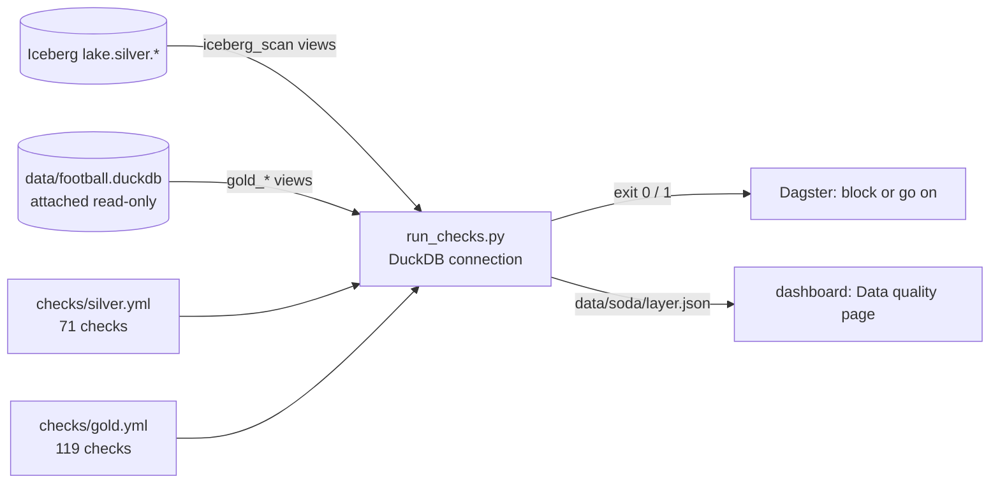

# Soda (data quality on Silver and Gold)

Soda Core runs SodaCL checks on both layers and stops the pipeline when the data is wrong (FOO-05). Rules come from
section 5 of [`docs/silver-guide.md`](../docs/silver-guide.md), the column lists and types from
[`docs/contrat_donnees.md`](../docs/contrat_donnees.md) (sections 9 and 10).



## Run it

Needs the stack (`make up`), Silver written (`make silver`) and, for Gold, `make gold`. Only Docker is needed:

```bash
make soda            # Silver then Gold; exit code 1 if a check fails or cannot run
make soda-silver     # Silver only (before building Gold: a failing Silver should stop the pipeline)
make soda-gold       # Gold only
make soda-demo       # shows the checks catching damaged data ON PURPOSE (nothing is written)
```

Each run prints the checks (`[PASSED]` / `[FAILED]`) and writes `data/soda/<layer>.json`, which the dashboard shows on its Data
quality page. For every check that did not pass the file carries a `detail`: how many rows break the rule and the first ones
(`2 failing row(s), first: match_id=m001, team_id=HOME, avg_shot_x=51.79`), the measured value, or the column whose type or
presence differs from the contract (`attacking_goal_x expected(DOUBLE) actual(decimal(11,1))`).

## What is checked

| Layer | File | Kinds of check |
|---|---|---|
| Silver | `checks/silver.yml` | **Contract**: columns and types of the 5 tables, no Kafka column left. **Grain**: one row per key (deduplication worked). **Not null**: keys, team, coordinates, flags. **Vocabularies**: `HOME`/`AWAY`, period 1/2, the 6 event types. **Football rules**: inside 105 x 68, speed <= 40 and never negative, exactly 22 players in every existing second, `is_sprint` consistent with the speed, goals in events = `home_score + away_score`, events oriented per team (HOME shots toward x = 105, AWAY toward x = 0). **Consistency**: every tracked player and event player exists in `silver_players` with the same team, tracking inside the player's playing time, ball in the seconds of the players. **Counts**: rows after deduplication equal the table of the Silver guide (m001, m002) |
| Gold | `checks/gold.yml` | **Contract**: columns and types of the 6 tables. **Grain**: one row per key. **Ranges**: no negative distance, no speed above 40, no player above 16 km, coverage 0 to 1, zone ids inside the 6 x 4 grid, shares of a player add up to 1. **Consistency between tables**: team totals = sum of the players, goals in `gold_shots` = score in `gold_team_match_stats`, final running score = final score, 5-minute windows add up to the tracked seconds, nobody passes to himself |

The Gold tables are also reconciled with Silver by dbt (`dbt/tests/assert_*.sql`): Soda guards the published tables,
dbt guards the transformation.

Measured on 2026-11-15 on m001 and m002 after one clean replay each: Silver 71 of 71 and Gold 119 of 119 pass. On the "m002" of the
original zip (SkillCorner 1927964, not the 1925299 of the docs) the row-count check fails, as it should: the data is not
the match the guide describes.

## The failure demo (`make soda-demo`)

The brief asks to demonstrate a failure on purpose. The runner damages the **views of its own run**, never the data:
Silver gets a duplicated tracking row and a player at x = 131.5 m running 61 km/h; Gold loses a goal. It then runs the
checks and succeeds only if they fail: on the test data, 6 Silver checks and 1 Gold check catch the damage.

## How it is built

- `run_checks.py` builds one in-memory DuckDB connection per layer and gives it to Soda. Silver tables become views
  `silver_<table>` over the Iceberg folders (`--silver-reader parquet` reads Parquet files instead); Gold is the dbt file
  attached **read-only**, one view `gold_*` per table. Soda never writes anything.
- **Why a separate image.** `soda-core-duckdb` 3.5.6 pins `duckdb==1.0.0`: it cannot open the Gold file (DuckDB 2.0) and
  would downgrade dbt's DuckDB. `soda/Dockerfile` installs `soda-core==3.5.6`, DuckDB 2.0 and the connector with
  `--no-deps`, on Python 3.11 (Soda 3.5 imports `distutils`). For the same reason Soda is **not** in `requirements.txt`.
  The CI has its own `soda` job with the same install.
- Settings (environment): `GOLD_DUCKDB_PATH`, `GOLD_S3_ENDPOINT` (`minio:9000`), `MINIO_ROOT_USER/PASSWORD`,
  `SODA_OUT_DIR`, `SODA_SILVER_READER`, `SODA_SILVER_WAREHOUSE`, `SODA_SILVER_NAMESPACE`, `SODA_SILVER_PARQUET_ROOT`.

Tests of the checks themselves: `tests/soda/` (healthy mini data passes, each kind of damage is caught). They need Soda
installed as above and are skipped otherwise.

## Not verified yet

- The `soda` container and the reading of the Iceberg folders through `iceberg_scan` on MinIO were not run (no Docker in
  the development sandbox): the checks ran on the same data as Parquet files and on the real Gold file. The risk is the
  same as for dbt (`dbt/README.md`): if `iceberg_scan` cannot read the Hadoop-catalog folders, use `SODA_SILVER_READER=parquet`.
- **Freshness** (listed in the first plan of this folder) is not checked: the Silver and Gold tables have no timestamp
  column, and a batch replay has no notion of lateness. A time check would need a `loaded_at` column in the contract.
- **Dagster** is not built yet: the exit code of `make soda` is what it will use to block the steps after a failure.

## Troubleshooting

**A check is red: read its `detail` first** (dashboard, page Data quality, or the JSON). The three failures seen on the first
real run, and what each one meant:

| Check | Detail | Cause and fix |
|---|---|---|
| events are oriented per team | HOME `avg_shot_x` around 34 to 54 instead of about 88 (the mean of two matches blurs to about 52) | Silver was written with the old `guide` rule: an older `spark/silver/` on disk, or `--events-direction guide`. The current job refuses to write such events (its report shows `events direction used`). Re-run `make silver MATCH="m001 m002"`, then `make gold` and `make soda` |
| row counts after deduplication equal the silver guide | `tracking=98516` against `expected_tracking=105534` | the tables hold another match than the guide describes (the zip shipped match 1927964 as m002). Re-run `make data` with the ids of `docs/data-sources.md`, replay, `make silver` |
| gold_shots follows the data contract | `attacking_goal_x expected(DOUBLE) actual(decimal(11,1))` | Gold was built before the column became `DOUBLE`. Run `make gold`, then `make soda-gold` |

A red result also stays red until `make soda` runs again: rebuilding a table does not refresh `data/soda/*.json`.


- `Catalog Error: Table with name silver_... does not exist` or an Iceberg error: Silver is not written, run `make silver`.
- `data/football.duckdb does not exist`: run `make gold`.
- `row counts after deduplication equal the silver guide` fails: the tables hold another match than the guide describes
  (check `source_match_id` in `data/prepared/<match>/manifest.json`), or a replay was written twice and Silver was not rerun.
- A check named `... follows the data contract` fails: a column was added, renamed or retyped. Change the contract
  (`docs/contrat_donnees.md`), the check file and the producing code together.
