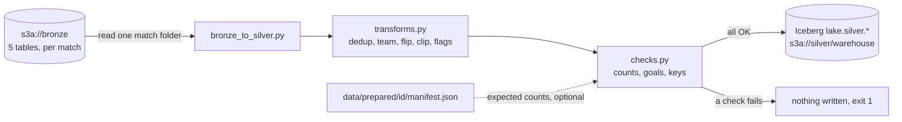

# Silver (Spark + Iceberg)

Bronze is raw on purpose (duplicates, no team on tracking, positions outside the pitch, directions
swapped at half-time). Silver cleans it and writes five Iceberg tables. The requirements are the table
in section 3 of [`docs/silver-guide.md`](../../docs/silver-guide.md); this folder implements exactly that.



## Files

| File | Role |
|---|---|
| `bronze_to_silver.py` | the command: reads bronze per match, cleans, checks, writes Iceberg |
| `transforms.py` | pure DataFrame functions, one per table (`clean_tracking`, `clean_events`...). No I/O |
| `checks.py` | metrics on the cleaned data and comparison with the ingestion manifest. No I/O except the manifest |
| `session.py` | SparkSession: S3A on MinIO and the Iceberg Hadoop catalog |
| `config.py` | pitch, thresholds, dedup keys, catalog and package settings (environment variables) |

Tests: `tests/spark/` (tiny hand-made match, local Spark, no Docker). Bronze code is not touched: the
job only reads `s3a://bronze/...` and reuses `ingestion.config` for paths and credentials.

## Run it

Needs the stack (`make up`), bronze filled for the match (`make bronze` + `make replay MATCH=m001`,
`make check MATCH=m001` all OK), Java 17+ and `pip install -r requirements.txt` (adds `pyspark`).
On Windows run it in WSL2 ([`docs/windows.md`](../../docs/windows.md)). From the repository root:

```bash
python -m spark.silver.bronze_to_silver --match m001 m002     # clean, check, write Iceberg
python -m spark.silver.bronze_to_silver --all                 # every match found in bronze
python -m spark.silver.bronze_to_silver --match m001 --dry-run   # clean + check only, writes nothing
```

The first run downloads the Spark packages (`hadoop-aws`, Iceberg runtime; see `config.py`).
Inside Docker set `MINIO_ENDPOINT=http://minio:9000`. Options: `--bronze-uri`, `--manifest-dir`,
`--packages`, `--events-direction` (see decision 1). `--help` lists them.

Idempotent: tables are partitioned by `match_id` and each run replaces the partition of the matches it
processes, so running again gives the same tables (no duplicates) and leaves other matches alone.

## What it does (guide section 3 -> code)

| # | Guide task | Where | Implementation |
|---|---|---|---|
| 1 | Deduplicate | `dedup` | one row per key (tracking: match_id, player_id, ts · events: event_id · ball: match_id, ts · players: match_id, player_id · matches: match_id); keeps the latest written copy, drops the Kafka columns |
| 2 | Do not trust file order | `clean_tracking` | windows are ordered by `ts` per player, output sorted by (player_id, ts); events by (ts, event_id), ball by ts |
| 3 | Add the team | `clean_tracking` | left join of Silver `players` on (match_id, player_id) |
| 4 | Flip directions | `normalise_direction` | where `home_side_pN` is `right_to_left`: x = 105 - x, y = 68 - y for tracking and ball (both teams). Events: see decision 1 |
| 5 | Correct positions | `clean_tracking` | `was_corrected` = outside 105 x 68 as delivered by bronze, then x clipped to [0, 105], y to [0, 68] |
| 6 | Speed | `clean_tracking` | `speed_kmh` kept as is (null stays null); `is_sprint` = speed_kmh > 25, false when null |
| 7 | Gaps | `clean_tracking` | no row is invented; `is_after_gap` = the previous tracked second of the player is more than 1 s earlier |
| 8 | Write Iceberg | `write_table` | `lake.silver.tracking / events / ball / players / matches`, `format-version` 2, partitioned by `match_id` |

## Output tables

Catalog `lake` (Iceberg Hadoop catalog, warehouse `s3a://silver/warehouse`), namespace `silver`.
Names are settable with `SILVER_CATALOG`, `SILVER_NAMESPACE`, `SILVER_WAREHOUSE`.

| Table | Grain | Columns |
|---|---|---|
| `silver.tracking` | player x second (FOO-03) | `match_id, player_id, team_id, period, ts, x, y, speed_kmh, is_sprint, was_corrected, is_after_gap` |
| `silver.events` | one action | the bronze columns without Kafka metadata: `match_id, event_id, ts, period, player_id, receiver_id, team_id, type, x_start, y_start, x_end, y_end, outcome` |
| `silver.ball` | second | `match_id, ts, period, x, y, z` |
| `silver.players` | player of a match | bronze columns without Kafka metadata |
| `silver.matches` | match | bronze columns without Kafka metadata |

Types: `ts`, `period` int; coordinates and speed double (2 decimals); `is_sprint`, `was_corrected`,
`is_after_gap` boolean (never null); everything else as in [`contrat_donnees.md`](../../docs/contrat_donnees.md).
Silver keeps the Kafka columns out: they only describe delivery.

## Decisions taken (and why)

1. **Events direction (OPEN, please confirm).** The guide says to flip events like tracking. Measured on
   m001, the source already gives event coordinates with the acting team attacking toward x = 105 (in
   both periods and for both teams). Applying the guide's rule puts HOME shots of period 2 near x = 15, and
   events 54 to 58 m away from the player's own tracking position (AWAY in period 1, HOME in period 2).
   Mirroring only the AWAY events gives events about 1 m from the player in all four team x period groups,
   and HOME shots toward x = 105 in both halves. The code supports both:
   `--events-direction guide` (default, literal guide) or `per_team` (mirror AWAY events only, recommended).
   The same switch exists as `SILVER_EVENTS_DIRECTION`. Decide before building Gold shot maps.
2. **Clipping applies to tracking only.** The guide's 735 / 618 figures are tracking rows. The ball leaves
   the pitch for real (558 ball rows outside in m001) and events end behind goal lines, so ball and events
   are mirrored but not clipped. Soda "inside 105 x 68" should therefore target `silver.tracking`.
3. **Speed is not recomputed after clipping.** It describes the movement between two real seconds.
4. **`is_after_gap` is false for a player's first row** (start of match or substitution): nothing is missing
   before it. In m001: 1,386 null speeds = 1,354 `is_after_gap` rows + 32 first rows.
5. **Which duplicate is kept:** the latest `ingested_at`, then `kafka_offset`. Copies carry the same values.
6. **Write mode:** replace the match partition (not `MERGE INTO`): a whole match is recomputed each run, which
   is simpler and idempotent.
7. **Catalog:** Iceberg Hadoop catalog on the silver bucket, no extra service. A REST or Hive catalog would
   need a new container in `docker-compose.yml`.

## Checks done before writing

The job prints a report and writes nothing for a match if one of these fails:

| Check | Source of truth |
|---|---|
| one row per key in tracking, events, ball, players | the keys above |
| row counts after dedup = prepared files (tracking, events, ball, players, matches = 1) | `data/prepared/<match>/manifest.json` (skipped if absent) |
| `was_corrected` rows = `rows_outside_pitch` (735 in m001) | manifest |
| null speeds unchanged (1,386 in m001) | manifest |
| every tracking row has a team, none outside 105 x 68 after clipping | computed |
| goals in events = final score (5 in m001, 2-3) | `matches` |

These are the job's gates, not the Soda checks of FOO-05 (22 players per second, speed <= 40, event types).

## Measured on m001 (SkillCorner 1874553, re-converted from the raw files)

Run on a copy of bronze built from the prepared files, replayed twice and shuffled (so duplicates and
disorder were present), local Spark, `--dry-run`:

| Table | Bronze rows read | Silver rows | Guide |
|---|---|---|---|
| tracking | 194,832 | 97,416 | 97,416 |
| events | 3,482 | 1,741 | 1,741 |
| ball | 8,856 | 4,428 | 4,428 |
| players | 64 | 32 | 32 |
| matches | 2 | 1 | 1 |

`was_corrected` 735, null speed 1,386, sprints 444, `is_after_gap` 1,354, goals 2-3, all checks OK.
x, y, flags and order were also compared row by row with an independent pandas computation: identical.

## Not verified yet

- The **Iceberg write** (`write_table`) and the S3A read were not run against your MinIO. The Maven jars
  could not be downloaded where this was developed. The package versions in `config.py` target Spark 4.0
  (`hadoop-aws` 3.4.1, `iceberg-spark-runtime-4.0_2.13` 1.10.0): confirm them on the first run, and keep the
  Iceberg artifact in line with the Spark minor version of `requirements.txt`.
- m002 numbers (105,534 tracking rows, 618 corrected, 0-1) come from the guide; the check compares with your
  own manifest, so run `make check MATCH=m002` first.

## Troubleshooting

- `a check failed ... rows after dedup`: the prepared files and bronze are not the same match. Compare
  `source_match_id` in `data/prepared/<match>/manifest.json` with `docs/data-sources.md`, re-run `make data`
  and replay again.
- `bronze is empty for [...]`: replay the match with `make bronze` running, then `make check MATCH=<id>`.
- Spark complains about `match_id` being both a column and a folder: the job already reads one match folder
  at a time; do not point `--bronze-uri` at a table folder.
- `ClassNotFoundException` for Iceberg or S3A: the packages were not downloaded (offline?): check `--packages`.
- `Connection refused` / `SignatureDoesNotMatch`: wrong endpoint or password; see `.env` and the ingestion README.
